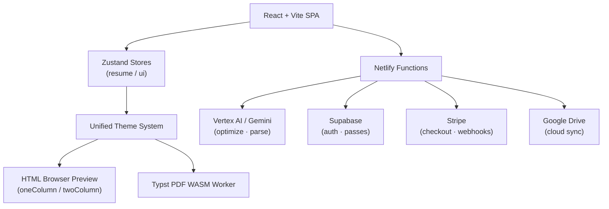

# Core Identity: KiwiCV

> **Last Updated: 2026-07-24** | [Wiki Index](INDEX.md)
> **KiwiCV** (formerly CVCanvas) is the resume product within the KiwiCanopy family. It combines approachable resume creation with progressively disclosed professional and technical depth.

## 🗺️ System Overview

The product is a client-heavy SPA: React state flows into the theme system for both live HTML preview and Typst PDF export, while a thin Netlify Functions backend brokers all external services.

## 🚀 The Vision

To provide a seamless bridge between structured data ([JSON Resume](https://jsonresume.org/schema/)) and professional, high-fidelity resume presentations (PDF and HTML).

## 💎 Core Pillars

1. **Approachable by Default**: New users can reach a strong result with minimal setup; advanced capability remains available on demand.
2. **Visual Excellence**: Every theme must feel premium and intentional. Generated CVs stay independent from the KiwiCV product brand.
3. **Modular Integrity**: The project uses a strictly modular architecture (Zustand slices, modular themes, modular editor) to remain maintainable at scale.
4. **Multilingual by Default**: Support for 15 languages with a custom modular translation system.
5. **ATS Optimized**: PDF exports are engineered to be machine-readable while remaining visually strong.
6. **AI-Enhanced**: Integration with Vertex AI (Gemini) for content optimization and resume matching.
7. **Agent-Centric Governance**: Documentation is managed by AI agents for AI agents. Models have the autonomy to restructure and optimize information to ensure maximum discoverability and speed of context retrieval.

## 🛠️ Tech Stack Baseline

- **Frontend**: Vite 8 + React 19 + TypeScript.
- **Styling**: TailwindCSS v4.
- **State**: Zustand (Modular domain slices).
- **PDF Export**: Typst WASM through `@myriaddreamin/typst.ts`.
- **Backend**: Netlify Functions (Node.js).
- **Data Model**: JSON Resume Schema v1.0.0.

## 📈 Current Project Status (July 2026)

- **Stable Version**: 3.x
- **Active Focus**: Rebranding CVCanvas to KiwiCV while preserving user data, provider continuity, and existing functionality.
- **Major Features**: 12 Visual Themes, 15 Locales, AI Optimizer, Stripe Integration.
