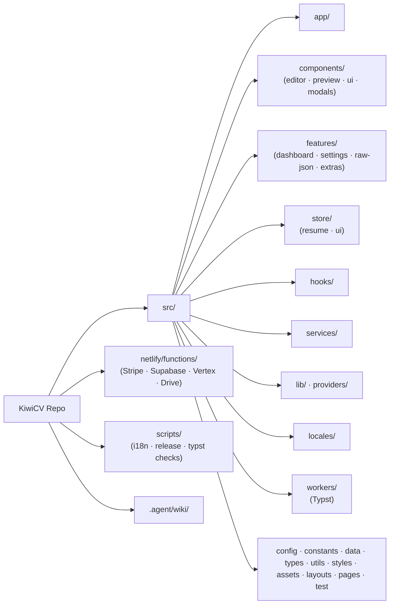

# Project Architecture

> **Last Updated: 2026-07-24**

## Overview

KiwiCV is a client-heavy React application built with Vite. It follows a feature-based modular structure to manage complexity across the editor, preview, and backend functions.

## Directory Map

```text
src/
├── app/                     # App bootstrap: routes, language routing, global overlays
├── assets/                  # Static assets (PDF icons, licenses)
├── components/
│   ├── editor/              # Form components (Modular patterns)
│   ├── preview/             # Theme system (HTML/PDF)
│   ├── ui/                  # Shadcn UI primitives
│   └── modals/              # Shared dialogs
├── config/                  # App/build configuration (brand, etc.)
├── constants/               # Shared constants (auth, cloud, urls, ...)
├── data/                    # Static data (changelog, sections)
├── features/
│   ├── dashboard/           # Main builder interface (Editor/Design/Preview)
│   ├── extras/              # Static content (Changelog, Roadmap, About)
│   ├── raw-json/            # Raw JSON editor
│   └── settings/            # App settings and sync config
├── hooks/                   # Shared React hooks (auth, cloud, sync, typst)
├── layouts/                 # Page shells (Main, Header, Sidebar)
├── lib/                     # Third-party client wrappers (Supabase, Sanity)
├── locales/                 # 15 language locale trees
├── pages/                   # Route-level page components
├── providers/               # React context providers (Auth, PostHog)
├── services/                # Storage adapters, GitHub integration
├── store/
│   ├── resume/              # Domain: Resume state + Logic (Modular slices)
│   └── ui/                  # UI state (Toasts, Modals, Sidebar, SEO)
├── styles/                  # Global CSS (tokens, animations, utilities)
├── test/                    # Test setup
├── types/                   # Type definitions (resume.ts = schema source of truth)
├── utils/                   # Pure helpers (validation, export, image, ...)
└── workers/                 # Web workers (Typst)

netlify/functions/           # Backend (AI, Auth, Payments) — repo root, not under src/
```

### Module Map



## Core Systems

### 1. Unified Theme System

Themes are split into HTML and PDF versions but share a single registry and utility set.

- **Reference**: [Theme System](THEME_SYSTEM.md)

### 2. Modular State (Zustand)

State is partitioned into domain-specific slices to prevent large file sizes and ensure focused updates.

- **Reference**: [State Management](STATE.md)

### 3. AI Logic (Vertex AI)

Decoupled backend logic handles prompt generation and response streaming.

- **Reference**: [AI Logic](../ops/AI_LOGIC.md)

### 4. Modular Editor & Modal Pattern

Complex components (forms, large modals) are strictly decomposed to maintain a < 300 line limit and high maintainability:

- `useX.ts`: The main entry hook, often orchestrating sub-hooks.
- `useXLogic.ts`: Specific logic extractions (e.g., `useAIGeneration`).
- `XItem.tsx`: Focused UI sub-components.
- `types.ts`: Shared interfaces and types.
- `utils.ts`: Pure helper functions.

### 5. "What's New" Highlight System

A marketing-driven feature discovery system that intelligently detects missed major releases.

- **Data Driven**: Uses `hasHighlights` flag in `src/data/changelog.ts` and `_highlights` metadata in locales.
- **Aggregation**: `MainLayout` calculates missed versions since `lastSeenVersion` and aggregates all highlight badges.
- **Dynamic Tour**: Highlights map to `data-tour` IDs, allowing the modal to trigger a targeted feature walkthrough.
- **Reference**: [Changelog & Highlights](../ops/CHANGELOG.md)

### 6. Anonymous Analytics (PostHog)

EU-hosted, cookieless, and strictly anonymous interaction tracking.

- **Infrastructure**: `PostHogProvider` configured with `memory` persistence and `cookieless_mode: 'always'`.
- **Anonymity**: No PII is captured; `identify()` and `alias()` are explicitly excluded.
- **Service Layer**: Centralized `AnalyticsService` singleton for unified tracking across the app.
- **Compliance**: GDPR-compliant by design, requiring no cookie banner.

### 7. Cloud Storage Structure (Unified Sync)

The cloud storage (GitHub/Google Drive) follows a strictly organized path system to separate deliverable assets from project source data:

- **`backups/{lang}/`**: Centralized repository for all resume source data.
  - `resume.json`: The "Manual Backup" representing the latest general state.
  - `{projectName}.json`: Immutable snapshots of the project at the time of export.
- **`exports/{projectName}/`**: Focused deliverable folders containing only final assets (PDF/HTML).
- **Hosting**: Hosting paths (e.g., `docs/index.html`) are configurable per project via `cloudConfig`.

### 8. Cloud Auth Gateway (`useSyncAuthGateway`)

A centralized security and UX controller that orchestrates all cloud-interactive entries.

- **Check Lifecycle**: Automatically validates GitHub PATs, Google Drive Refresh Tokens, and active Supabase sessions.
- **Ensure Connected**: A single entry point that either executes a callback (if connected) or redirects to the appropriate login/setup modal.
- **Consistency**: Used in `ExportModal`, `CloudBackupManagement`, and `Settings`.

### 9. Cloud Restore Pipeline (`useCloudRestorePrompt`)

Restoration of cloud backups is managed via a decomposed, pipeline architecture to maintain strict line limits (< 300) and discrete responsibilities:

- **Discovery (`useCloudDiscovery`)**: Responsible solely for querying GitHub/Google Drive to locate available `.json` backups.
- **Operations (`useCloudOperations`)**: Encapsulates specific API requests for downloading and permanently deleting backups.
- **Orchestration (`useCloudRestorePrompt`)**: Consumes the discovery and operations hooks to sequence UI prompts, trigger management modals, and handle the final data hydration into Zustand.
- **Reference**: [Cloud Sync & Migration](CLOUD_SYNC.md)

---

_Derived from legacy core/architecture.md_

### 10. Modular Backup Selector (`cloud-backup-selector`)

The `CloudBackupSelectorModal` is decomposed into a specialized directory to handle complex filtering and sorting logic:

- **`useBackupFilters.ts`**: Manages active filter sets (Date, Position, Company, Theme) and computes the filtered/sorted project list.
- **`BackupFilterControls.tsx`**: Implements a dynamic filter selection bar where users can toggle specific input fields.
- **`BackupFileItem.tsx`**: Standardized row component for displaying backup metadata and actions.

### 11. Resizable Dashboard Layout

The main builder interface features a high-performance, draggable side-by-side view.

- **Direct DOM Manipulation**: To achieve 60fps performance during dragging, the `ResizableDivider` updates a CSS variable (`--editor-width`) directly on the `DashboardLayout` container's style object, bypassing React's render cycles for layout updates.
- **State Persistence**: The final width is synchronized back to the `useUIStore` only when the drag operation ends, ensuring the user's preferred layout is persisted across sessions without impacting performance.
- **Self-Healing Mechanics**: A validation `useEffect` in the layout root ensures that the stored width always respects a **480px minimum** for both the editor and preview panes. It automatically corrects the state if window resizing or monitor switches invalidate the previous layout.

### 12. Marketing Entry Point & Routing

The application implements a marketing-first routing architecture that separates the public-facing funnel from the editor workspace.

- **Root Route (`/:lang/`)**: Hosts the marketing `LandingPage`, which replaces the legacy Welcome Modal. It focuses on high-converting CTAs and feature showcases.
- **Dashboard (`/:lang/dashboard`)**: The main application entry point where the CV editor resides.
- **Sidebar State**: The sidebar remains persistent across both the landing page and the dashboard, providing a "Home" navigation point to allow users to return to the marketing overview at any time.
- **Animation Philosophy**: To ensure stability on mobile devices and during window resizing, the landing page uses **Stable CSS Animations** (Intersection Observer + Tailwind) instead of runtime-heavy libraries like GSAP.

### 14. Blog Rendering System (Sanity + Markdown)

The blog utilizes a hybrid headless approach combining Sanity.io for content management with a local Markdown-first rendering engine.

- **Content Flow**: Posts are fetched from Sanity as raw Markdown and rendered using `react-markdown`.
- **`OptimizedMedia` Component**: Custom handler for GIFs, Videos, and Images to ensure visual consistency across devices.
  - **Hardware Acceleration**: Automatically uses video tags for GIFs and video files.
  - **No-Gap Logic**: Employs a `w-fit` container and centered positioning to eliminate "white borders" without requiring background blurs or cropping.
  - **Resource Management**: `IntersectionObserver` pauses videos when off-screen.
  - **Design Standard**:
    - **Hero**: Max-height 500px, width follows natural aspect ratio (centered), never cropped.
    - **Article**: 50% desktop width (sm+), 100% mobile width. Upscales small media to fill the width.
    - **Aesthetics**: `rounded-[2rem]` corners and premium shadows (`shadow-lg`). Uses a soft `blur-sm` to `blur-0` transition while media is loading for a premium editorial feel.
