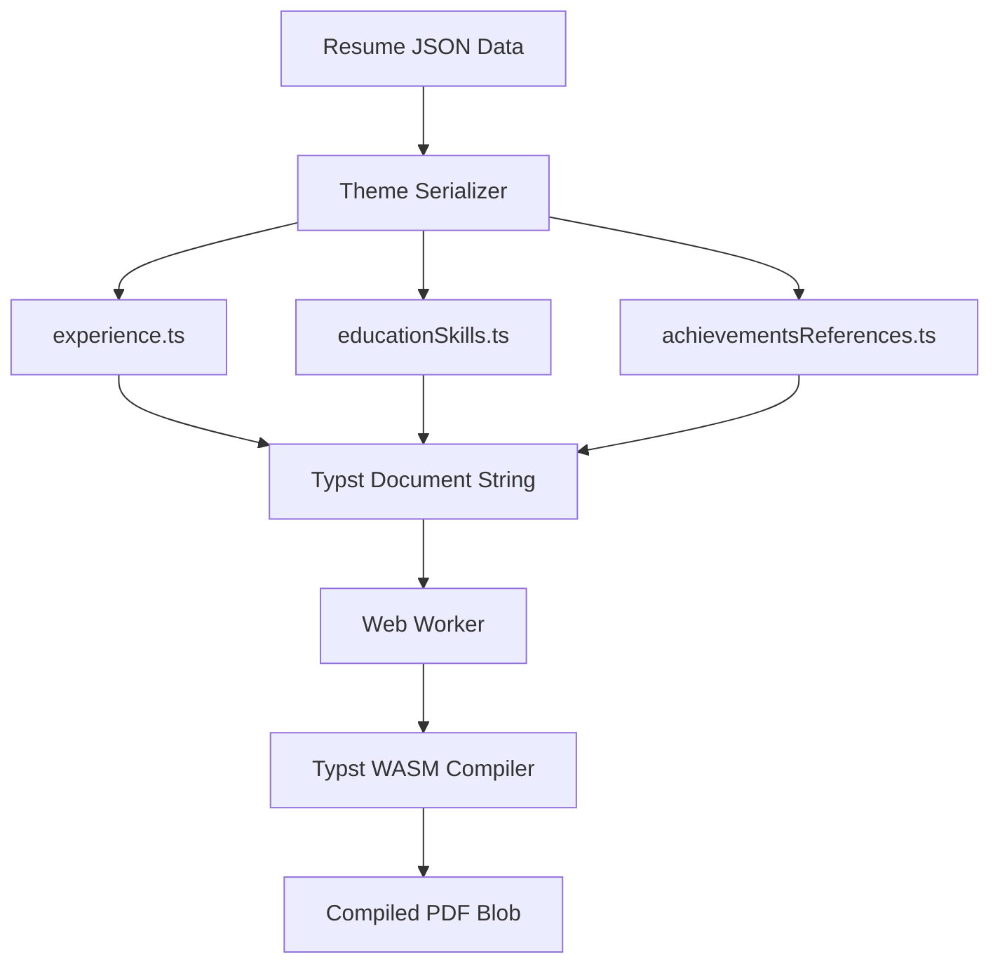
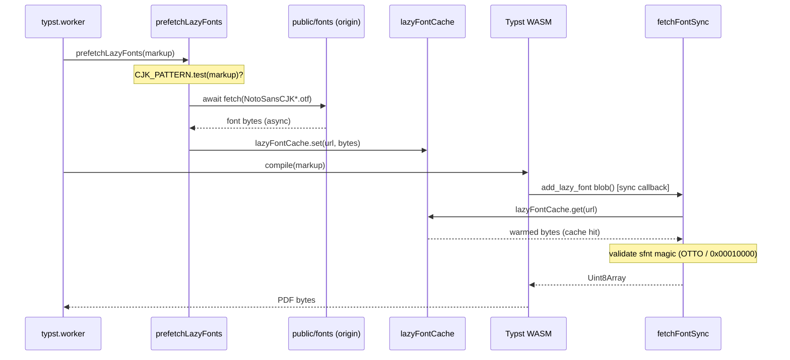

# Typst PDF Rendering Engine

> **Last Updated: 2026-09-05**

## Contents

- [Overview](#overview)
- [Runtime Assets: Everything Is First-Party](#runtime-assets-everything-is-first-party)
- [Text Escaping & URL Sanitization (2026-07-24)](#text-escaping-url-sanitization-2026-07-24)
- [Compile Smoke Test (2026-07-25)](#compile-smoke-test-2026-07-25)
- [Rendering One Theme to a PDF You Can Open](#rendering-one-theme-to-a-pdf-you-can-open)
- [See Also](#see-also)

This page covers the **compile engine and runtime**: the WASM worker, eager and
lazy font handling, the compile flow, the Typst-syntax escaping gotchas, and the
local CLI test-compile. For how to **author** a theme's serializer (directory
layout, coordinating shell, layout conventions) see
[TYPST_THEME_AUTHORING.md](./TYPST_THEME_AUTHORING.md).

## Overview

The KiwiCV Typst PDF generation engine compiles resume templates directly to high-fidelity PDF documents in the browser via WebAssembly (using `@myriaddreamin/typst.ts`). It is the **sole** PDF engine — the former `@react-pdf/renderer` path has been fully removed (`react-pdf` is no longer a dependency) — and every theme renders through it: Elegant, JavaScript, Plain, Plain2, StackOverflow, Timeless (one-column) and Foggy, Lunar, Misty, Skyline, Soft, Swiss-Grid (two-column).



---

## Runtime Assets: Everything Is First-Party

[typst.worker.ts](../../../src/workers/typst.worker.ts) loads three kinds of
binary at first compile, and **none of them may come from a third party**.

| Asset                       | Where it comes from                                                                                                                                                                                                   |
| --------------------------- | --------------------------------------------------------------------------------------------------------------------------------------------------------------------------------------------------------------------- |
| Compiler WASM (~28 MB)      | `@myriaddreamin/typst-ts-web-compiler/pkg/*.wasm?url` — Vite emits a hashed asset                                                                                                                                     |
| Renderer WASM (~1 MB)       | `@myriaddreamin/typst-ts-renderer/pkg/*.wasm?url` — same                                                                                                                                                              |
| 12 eager faces (~1 MB)      | `public/fonts/`, fetched from `self.location.origin` at first compile — the list is `EAGER_FONT_FILES` in [eagerFonts.ts](../../../src/workers/eagerFonts.ts), imported by both the worker and the compile smoke test |
| 2 lazy CJK faces (~31.4 MB) | `public/fonts/`, fetched only when a CJK glyph is used — see below                                                                                                                                                    |

Until 2026-07-23 the two WASM modules and 8 of the 14 faces were fetched from
`cdn.jsdelivr.net` at runtime. That put a third party in the path of the
default view: `viewMode` defaults to `'pdf'`, so a blocked, slow, or offline
CDN produced an empty preview on a fresh load — and contradicted the "stays in
this browser" promise. It also let font loading fail _silently_: each fetch
falls back to an empty buffer and merely warns, so a partial CDN failure
downgraded the rendered PDF rather than erroring.

Three things worth carrying forward:

- **The `?url` import pins the version.** The old URLs were unversioned
  jsDelivr `@latest`-style paths, so the runtime compiler could drift away from
  the installed `@myriaddreamin/typst.ts`. Resolving through node_modules means
  the WASM always matches the package lock.
- **`typst.ts` adds jsDelivr fonts unless told not to.** `TypstCompilerDriver.init`
  pushes `loadFonts([], { assets: ['text'] })` — 17 files from `cdn.jsdelivr.net`
  — whenever no font loader in `beforeBuild` states `assets`. Until 2026-10-12
  neither the worker nor the test harness did, so every browser fetched them on
  its first compile, only for `setFonts` to replace them. A blocked CDN rejected
  the compiler start and failed the preview outright, and every Typst test
  depended on the CDN. Both now take `typstFontLoaders()` from
  [eagerFonts.ts](../../../src/workers/eagerFonts.ts), which passes
  `assets: false`; `typstOffline.test.ts` fails on any fetch during the harness's
  compiler start, and scans the worker for the call. Grepping `dist/` for `jsdelivr` still finds the dead default URL.
- **`getTypstFontList('sans')` names `Noto Sans`, which is not registered.**
  The worker loads Noto Sans **CJK** SC/JP but not the Latin/Cyrillic
  `noto-sans-regular.ttf` that also sits in `public/fonts`. Cyrillic and Greek
  resolve through `DejaVu Sans` at the end of the stack instead. Harmless
  today; do not read the stack as proof of what is loaded.

Adding a face means putting the file in `public/fonts` and adding its name to
`EAGER_FONT_FILES` in [eagerFonts.ts](../../../src/workers/eagerFonts.ts) (it moved out of the worker on 2026-07-25). Do not reintroduce a remote URL.

### The two CJK faces are lazy (2026-07-23)

The two Noto Sans CJK faces are ~15.7 MB each. Registering them eagerly meant
**every** first preview pulled ~34 MB brotli — 24 MB of it CJK — before
anything could render, for a CV usually holding no CJK character.

They now use `typst.ts`'s lazy-font path: `src/workers/lazy-font-info.json`
holds each face's family, variant and a run-length-encoded **coverage table**
— 19 KB standing in for 31.4 MB — and the worker calls
`fontBuilder.add_lazy_font(info, blob)`, so Typst invokes `blob` only if a
glyph resolves to that face. **Font selection is unchanged**: the table is the
one Typst would compute from the file, so this defers the download without
narrowing what the compiler knows.

The pipeline splits the work across an **async prefetch** and a **synchronous
callback** so the blocking download never happens inside the compile:



Three things that will bite you here:

- ⚠️ **The blob callback is synchronous, so the download must not happen inside
  it.** Typst wants a `Uint8Array` back mid-compile, so `fetchFontSync` uses a
  **blocking XHR** — tolerable only in a worker. But pulling 15.7 MB on a
  thread that cannot yield **exceeded the 30 s compile timeout** in
  `useTypst.ts`: a CJK CV failed with "taking longer than expected" on the
  deploy preview while passing locally, where the file is on disk.
  `prefetchLazyFonts` therefore scans the markup for CJK **before** the compile
  and awaits a normal `fetch`; the callback then serves from cache. That scan
  is a **prefetch hint, not a correctness gate** — Typst still picks faces from
  the coverage tables and the sync path remains a fallback, so a missed
  codepoint costs latency, not glyphs. Never make `fetchFontSync` async.
- **A missing font does not 404.** The dev server and Netlify's SPA rewrite both
  answer `index.html` with **status 200** (verified on the deploy preview), so a
  status check alone hands Typst HTML as a typeface. `fetchFontSync` validates
  **sfnt magic** — `OTTO` for the CFF Noto faces, `0x00010000` for TrueType.
- **Regenerate the metadata when a face changes** (`npm run fonts:generate-info`).
  `tests/lint/font-info.test.mjs` compares the recorded SHA-256 and fails on
  drift — a stale coverage table makes Typst skip a face that does cover a glyph
  (tofu) or fetch 15.7 MB for one that does not, neither of which errors.

Verify **both** directions — each alone passes for the wrong reason. Delete
both `.otf` files and confirm a Latin CV still renders (the callback throws on
a bad response, so a render proves it never ran); then put CJK text in a CV
**on a deploy preview** (local disk hides the download cost that broke this
once) and confirm `/BaseFont` in the PDF bytes names `NotoSansCJKsc-*` — the
embedded viewer paints blank in screenshots, so a screenshot proves nothing.

---

## Text Escaping & URL Sanitization (2026-07-24)

User text reaches Typst in **two different syntactic contexts**, and each has
its own escaper in [typstUtils.ts](../../../src/components/preview/themes/shared/typstUtils.ts).
Using the wrong one either loses text or prints stray backslashes:

- **`escapeTypst(text)` — markup/content context**, i.e. inside `[...]` blocks.
  Escapes the full markup character set. Beyond the long-standing set
  (`\ # $ [ ] _ * < > @`), it also escapes `/` (a bare `//` starts a Typst
  line comment and silently swallowed the rest of the line — e.g.
  "24/7 // on-call"), backticks (an unbalanced one opens raw text), `~`
  (non-breaking space), and line-start heading/list/enum markers
  (`=`, `-`, `+`, `1.`).
- **`escapeTypstString(text)` — string-literal context**, i.e. inside
  `"..."` arguments such as `#theme-section("...")` or
  `#plain-entry(description: "...")`. Typst displays string content
  **verbatim**, so markup escaping must NOT be used here — its backslashes
  show up in the PDF (this bug shipped for `*`/`_`/`#` before 2026-07-24).
  Only `\`, `"`, and newlines are escaped.

Rule of thumb when writing serializer markup: `[${escapeTypst(x)}]` and
`"${escapeTypstString(x)}"` — never mix them.

**URLs**: every `#link("...")` destination must go through `sanitizeUrl(url)`.
It allowlists `http`/`https`/`mailto` and neutralizes anything else
(`javascript:`, `data:`, `file:` …) by prefixing `https://`, producing a
dead-but-safe link. It also escapes `"`/`\` so a crafted URL cannot break out
of the Typst string literal and inject markup. It deliberately never returns
an empty string for a truthy input, because **Typst rejects `link("")`**
("URL must not be empty") — do not "improve" it to return `''`.

Unit tests with the problem strings live in
`src/components/preview/themes/shared/__tests__/typstUtils.test.ts`.

---

## Compile Smoke Test (2026-07-25)

`npm test` compiles **every theme's Typst output**, rather than only asserting
on the emitted string.

Why it exists: three crashes shipped through a green suite (one,
then two misty variants),
all the same shape — a **single-element Typst tuple**. `([x])` is grouping,
`([x],)` is an array, and only the latter answers `.map()` or `.len()`. The
serializer tests check substrings, and the broken form is a perfectly plausible
substring. Each of the three failed the entire PDF export.

| Piece                                                            | Where                                                   |
| :--------------------------------------------------------------- | :------------------------------------------------------ |
| Harness (WASM compiler init, icon shadow-mapping, `%PDF-` check) | `src/test/typstCompile.ts`                              |
| Fixture — **exactly one** of every array-bearing field           | `src/test/singleItemResume.ts`                          |
| Table test                                                       | `src/components/preview/__tests__/typstCompile.test.ts` |

Five properties worth knowing before changing it:

- **It uses the app's own WASM compiler, not the `typst` CLI.** The CLI is not a
  dependency of this repository, so a CLI-backed test needs a skip-if-missing
  gate and CI never runs it. It is also a different compiler generation from the
  pinned WASM module, so it can accept markup production rejects. The WASM path
  needs no environment and costs ~800 ms for 24 compiles.
- **One is the only arity that reaches the bug** — at zero there is no tuple, at
  two the markup is already a valid array. Do not "improve" the fixture by
  giving a section two items.
- **Two-column themes are compiled in three layout variants** (default, all
  `main`, all `sidebar`). The misty crash was in the `isSide` branch.
- ⚠️ **An empty `twoColumn` order compiles a document with no sections, and
  passes.** `initialResumeState` ships that order empty and `migrateLayoutMetadata`
  does not fill it, so the fixture calls the production layout getters instead.
  This bug was in the first draft of the fixture and made every two-column case
  vacuous. The one-column path is self-healing (`getEffectiveSectionOrder` falls
  back to the theme default), which is what makes the failure asymmetric and easy
  to miss.
- **The WASM module is found by module resolution** — the rule is in
  [ops/TESTING.md § Paths in tests](../ops/TESTING.md#paths-in-tests).
  A fixed path failed all six compile suites in a nested worktree.

A new theme is compiled automatically once its id is in `ALL_THEME_IDS`; there
is no per-theme test to write.

⚠️ **It asserts "the compiler accepted it", not "the output is right", and not
"warning-free".** `$typst.pdf` resolves on warnings, and the harness does not
inspect diagnostics — `unknown font family: noto sans` is emitted on every run
today and nothing fails. It also registers only the eager Latin faces, so no
CJK path is covered. Layout regressions, wrong glyphs and missing content are
all outside its reach by design.

## Rendering One Theme to a PDF You Can Open

The smoke test proves the compiler accepted the markup. To actually **look** at
a theme's output:

```bash
RENDER_THEME=elegant npm run pdf:render
RENDER_THEME=lunar RENDER_FIXTURE=placeholder npm run pdf:render
```

It writes `scratch/<theme>-<fixture>.pdf` and prints the path. `RENDER_FIXTURE`
is one of:

| Fixture              | What it is                                                                                    |
| -------------------- | --------------------------------------------------------------------------------------------- |
| `single`             | the suite's one-item fixture (default); no profile image                                      |
| `placeholder`        | the new-user resume; carries a profile image                                                  |
| `real`               | the newest `examples/` snapshot — the only one with realistic density                         |
| `letter-long`        | `single` with a cover letter that overflows its own page                                      |
| `letter-classic`     | `single` with the DIN 5008 letter branch                                                      |
| `placeholder-letter` | `placeholder` with a matching letter, the pair the print flyers show; honours `RENDER_LOCALE` |
| `letter-preset`      | `single` with the `long` length preset in real prose — what the calibrated word count fills   |
| `letter-max`         | `single` with `COVER_LETTER_MAX_WORDS` of prose — the two-page end of the user range          |

The `letter-*` fixtures exist because the cover letter is **PDF-only** —
nothing renders it in the HTML preview, so compiling is the only way to see a
change to it. `placeholder-letter`, `letter-preset` and `letter-max` honour
`RENDER_LETTER=classic` for the DIN 5008 branch.

### The cover-letter length presets are measured here, not derived

`COVER_LETTER_PAGE_WORDS` in `src/components/preview/letterCapacity.ts` is how many words of
application prose fit on the letter's first page, per theme and layout at
`fontScale` 1. Every entry was read off a compile through the shipped WASM, and
`src/components/preview/__tests__/coverLetterCapacity.test.ts` keeps it true
in both directions:

- `npm test` renders every entry from both sides at `fontScale` 1 — the entry
  fits on one page and ten more words spill — and the `long` preset at 0.8 and
  1.5, where the estimate has to stay under the render;
- `MEASURE_LETTER=1 npx vitest run coverLetterCapacity` is the sweep that
  produced the table — a binary search per theme and layout, plus a scan across
  font scales. Re-run it after a theme restyle that moves the letter's header,
  margins or type size, and paste the new row into the table and into the
  `SWEEP` literal in `src/utils/__tests__/coverLetterLength.test.ts`, which
  pins the estimate away from scale 1 against it.

⚠️ The epic's arithmetic (`380` classic / `660` themed off the geometry
constants) was wrong in both directions: the themed layout spreads from 485
(foggy) to 815 (elegant), so one constant either overflowed foggy or wasted a
third of elegant. Above `fontScale` 1 the capacity also falls faster than
`1/fontScale²`, because the letter's furniture scales with the font and takes a
growing share of a fixed page; `coverLetterLength.ts` carries a per-layout
correction (`COVER_LETTER_FURNITURE_RATIO`) set so the estimate stays under the
render at every swept point — by over 40% on the themed layout at 1.5, which the
unit test bounds at half; that is the price of never promising a page that
spills. Below 1 the plain squared law errs short or lands within the five-word
step (lunar, soft and swiss_grid classic at 0.8 sit exactly on the step); on
the themed layout it is under by up to ~16%.

### Chinese and Japanese are measured in characters, in their own file

`COVER_LETTER_PAGE_CHARS` is the same table for the two languages a word count
cannot describe — Chinese and Japanese are written without spaces, so
`countCoverLetterWords` scores a whole paragraph as one or two tokens.
Swept the same way, by `coverLetterCapacityCjk.test.ts`, to the nearest ten
characters.

⚠️ **It is a separate file because the CJK faces are a separate font
registration, and getting that wrong is silent.** `src/test/typstCompile.ts`
registers only `EAGER_FONT_FILES`; the two 16 MB Noto Sans CJK faces are
fetched lazily over HTTP by `typst.worker.ts`, which does not exist in Node. An
unregistered family is a Typst **warning**, not an error, so the compile still
succeeds — with different pagination. Measured 2026-09-08 on 8,800 identical
CJK characters at 11 pt:

| font registration                                | pages |
| ------------------------------------------------ | ----- |
| eager faces **+ `noto-sans-cjk-sc-regular.otf`** | **5** |
| eager faces only                                 | **3** |

A sweep run without the face would have overstated a page by ~67%, with every
check green. `initTypstCompiler({ cjk: true })` is what registers them;
the start-up promise is module-level and `setCompilerInitOptions` is global, so a file
cannot have it both ways — hence the second file, since vitest isolates module
state per file. The ungated both-sides assertion is also the font guard: a
capacity that holds from both sides cannot hold on the wrong glyphs.

⚠️ **One table for both scripts, and that is a measurement.** Swept separately
for `zh` and `ja`, the two never differed by more than **10 characters** — one
step — across all twelve themes and both layouts, and `ja` was never the larger,
so the table is the `ja` reading and errs short for `zh` by at most a step.
⚠️ The stronger reason is structural: `TYPST_FONTS` lists `Noto Sans CJK SC`
ahead of `Noto Sans CJK JP`, so **both scripts resolve to the SC face** — there
was never a second face for the two readings to disagree about. A step-10 sweep
also cannot resolve a difference of ≤10, so the agreement bounds the true gap to
under 20 characters rather than proving it zero. Re-measure before extending
`COVER_LETTER_CHARACTER_LANGS`; this is a property of the font stack, not of CJK.

⚠️ **The ratio to the word table is not constant enough to derive from** — it
spans **2.13 to 3.14** across the 24 theme/layout cells (median 2.58), with only
six inside 2.4–2.6. Read a value, never compute one. The one
place 2.5 is used is `COVER_LETTER_CHARACTER_CLAMP_FACTOR`, which widens the
advisory min/max bounds; without it a character target is capped by
`COVER_LETTER_MAX_WORDS` and `long` silently asks for about half the promised
letter.

It is a vitest file (`src/components/preview/__tests__/renderThemePdf.test.ts`)
gated `describe.skipIf(!process.env.RENDER_THEME)`, so `npm test` skips it and
it cannot fail CI. It indexes `SERIALIZERS` (`Record<ThemeId, …>`) with
`Object.hasOwn`, so it carries no theme list of its own and an unknown id fails
loudly against the real one.

A test file rather than a `scripts/` entry point because vitest supplies
everything a standalone runner would need a new dependency for: `@/`
resolution, `__APP_VERSION__`, and the dummy `VITE_SUPABASE_*` values at
`vite.config.ts:27-30`. ⚠️ That last one is worth stating precisely, because it
is easy to record as "the Supabase problem is solved": it is not. The render
file's import graph still reaches `src/lib/supabase.ts` — through
`ThemeRegistry` → `themes/shared` → `shared/address.ts`, which imports the
store — exactly as the deleted script's did. Delete those four lines of
`vite.config.ts` and `npm run pdf:render` dies the same `supabaseUrl is
required.` death. What changed is the runner, not the graph.

⚠️ **It does not check the compile is warning-free either.** That was the
deleted script's advertised job, and nothing replaced it: `$typst.pdf` resolves
on warnings and no path in the repository inspects diagnostics, so
`unknown font family: noto sans` fires on every run today and nothing notices.
A new theme naming a font that is not in `public/fonts` passes `npm test` and
`pdf:render` both.

⚠️ **`scripts/test-typst-compile.ts` is gone**,
and this page previously claimed it "still writes a PDF" when it had not run at
all for some time. It was dead **three** ways, not the one env problem
documented here: `vite-node` is in neither `dependencies` nor
`devDependencies`, so `npx vite-node scripts/test-typst-compile.ts <theme>`
fetched a floating copy that could not resolve `@/` and died on the first
aliased import it reached (observed 2026-07-25 as
`Failed to load url @/components/preview/ThemeRegistry`); the `typst` CLI is not
a dependency either, and an installed 0.15.x is a different compiler generation
from the pinned 0.7.0 WASM; and its import chain pulled `src/lib/supabase.ts`,
which throws `supabaseUrl is required.` without a `.env`. It also carried a
hand-written twelve-branch `if (theme === …)` chain whose section orders had
already drifted.

---

## See Also

- [TYPST_THEME_AUTHORING.md](./TYPST_THEME_AUTHORING.md) — serializer authoring
  guide: directory layout, coordinating shell, and the core layout conventions.
- [THEME_SYSTEM.md](./THEME_SYSTEM.md) — the theme architecture (HTML preview,
  serializer registry, and shared helpers).
