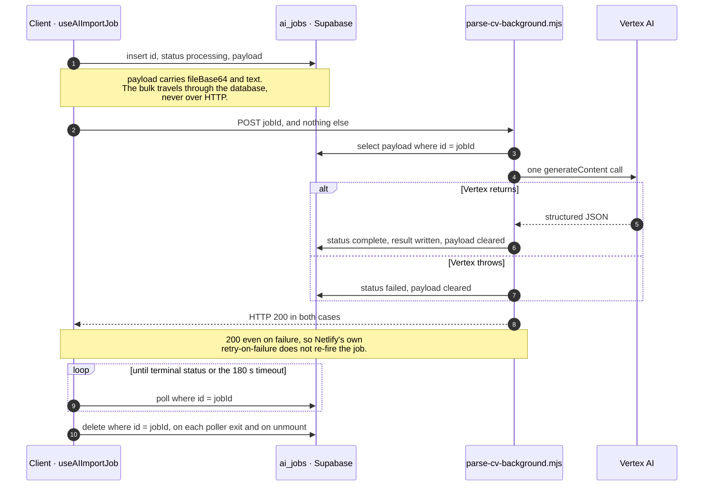

# AI Logic & Vertex AI Integration

> **Last Updated: 2026-10-13** (proposal keys built by one helper; a custom section heading proposal is reviewed at its title; truncation, translation completeness and its cap; the tailoring facts and skill keywords held server-side; one list-entry matcher; one job-run lifecycle for both dialogs; the request guards; the server serves only composed targets; the two CV merges pinned; one comparator rule; an `item:` run is a list entry; custom sections; the length unit; one inventory of object-shaped sections)

## Contents

- [Overview](#overview)
- [Architecture: The Four Pillars](#architecture-the-four-pillars)
- [Backend Implementation](#backend-implementation)
- [Prompt Engineering](#prompt-engineering)
- [The cover-letter call](#the-cover-letter-call)
- [Frontend Implementation (Modular Patterns)](#frontend-implementation-modular-patterns)
- [Maintenance & Iteration](#maintenance-iteration)
- [Mock Mode (Testing & QA)](#mock-mode-testing-qa)
- [Usage Tracking Logic](#usage-tracking-logic)

## Overview

KiwiCV integrates with **Google Vertex AI** — renamed **Gemini Enterprise Agent Platform** by Google in 2026 — (using the Gemini model named by `VERTEX_CONFIG.MODEL` in `netlify/functions/lib/ai/constants.js` — read it there rather than from this sentence, which named `gemini-3.1-flash-lite` for a month after the constant had moved on) to provide resume optimization, content suggestions, and matching capabilities. Requests go to the **EU multi-region REP endpoint** (`aiplatform.eu.rep.googleapis.com`, location `eu`, residency restricted to EU member states); Gemini 2.5 models are deprecated there on 2026-10-20 (ELA pricing rises 2027-01-28).

## Architecture: The Four Pillars

The AI system is built on four architectural pillars:

1. **Universal Background Processing**: All AI tasks (CV, Section, Item) are executed asynchronously via Netlify Functions and polled from the `ai_jobs` table to prevent timeouts.
2. **Decoupled Logic**: AI logic is separated into Netlify Functions to keep the frontend lightweight and secure.
3. **Modular Prompts**: Prompts are managed in `netlify/functions/lib/ai/prompts.js`, allowing for easy iteration and versioning.
4. **Structured Output**: The system enforces JSON output from the LLM to ensure direct compatibility with the resume schema.
5. **Service Layer**: A dedicated library (`netlify/functions/lib/ai/`) handles tokenization, logging, and response generation.

## Backend Implementation

- **Entry Points**: `netlify/functions/improve-cv-background.mjs` (edit/improve) and `netlify/functions/parse-cv-background.mjs` (import/parse) handle the long-running AI requests.
- **Job Tracking**: Background jobs are logged in the `ai_jobs` table and results are retrieved via polling.
- **Request guards**: `lib/ai/request.js` (`validateImproveRequest`) is the improve worker's whole request-body validation — required fields, the free-text and job-description caps, the letter-only precondition, the CV payload cap and the whole-CV translation cap — as a pure function run after auth and before the profile or the allowance is read. It also returns `translatesWholeCv`, the worker's one definition of a whole-CV translation, which decides whether the response is graded for completeness. Its codes land in `ai_jobs.error` and show the generic error: the frontend branches only on `PREMIUM_REQUIRED` and `LIMIT_REACHED`, thrown later (`.claude/rules/ai-backend.md` § Error codes). `improve-request-guards.test.mjs` pins each code without a Supabase stub.
- **Prompts**: `prompts.js` contains the system instructions and task-specific templates.
- **Vertex Client**: `vertex.js` owns the actual Vertex AI call — a service-account JWT exchange (`getAccessToken`) followed by one `generateContent` fetch (`getVertexResponse`). There is **no retry loop**: a failed call throws, the job row is marked `failed`, and the background function deliberately still returns HTTP 200 so Netlify's own background-function retry-on-failure does not re-fire it.
- **Generators**: `generator.js` does **not** call Vertex — it builds the `responseSchema` objects (`getVertexResponseSchema`, `getParsingSchema`) that `vertex.js` sends as `generationConfig.response_schema`, from the field compositions in `definitions.js`.
- **Definitions**: `definitions.js` defines `FIELD_DEFS` and the `SECTION_COMPOSITION` / `PARSING_COMPOSITION` / `TRANSLATION_COMPOSITION` tables that `generator.js` reads.

### Three response shapes, and why a section has to pick one

`getVertexResponseSchema` builds one of three shapes for a section target. They are not
interchangeable: each one is a contract with a different branch of the frontend's
`applySectionSuggestion`, and picking the wrong one produces a run that succeeds, bills, and
writes nothing.

| Shape                  | Response                                | For                                                                |
| ---------------------- | --------------------------------------- | ------------------------------------------------------------------ |
| `buildItemSchema`      | `items[]` of `{ _vId, improvedFields }` | every list section                                                 |
| `buildReorgItemSchema` | `items[]`, flat, with `_sourceVIds`     | skills, when the reorg toggle is on                                |
| `buildSingletonSchema` | `{ improvedFields }`                    | `SINGLETON_SECTIONS` — a section that is ONE object, on every path |

`SINGLETON_SECTIONS` is the backend's one inventory of object-shaped sections — read its
contents from `definitions.js`, not from here. An object section has no `_vId`, so the item shape makes the model
invent an identifier that matches nothing on the way back — and `applySectionSuggestion`
would find neither a `basics` key nor an array and write nothing at all. That is exactly what
an earlier cover-letter schema shipped, before the letter got the singleton shape.

**`basics` moved onto it on 2026-09-08, measured first.** Five runs per arm,
gemini-3.5-flash-lite on the EU endpoint, the real basics from `examples/resume_4_3_5.json`,
the shipped `section:basics` prompt, default temperature; the two schemas differed only in
`_vId`.

| Arm                       | `_vId` returned                                           | `improvedFields`                                                       |
| ------------------------- | --------------------------------------------------------- | ---------------------------------------------------------------------- |
| item shape (shipped)      | `"0"`, `""`, `"summary_001"`, `"1"`, `"john_doe_summary"` | 5/5 valid, all graded as changes; every run opened "Results-driven…"   |
| singleton shape (adopted) | absent                                                    | 5/5 valid, all graded as changes; every run opened "M.Sc. … graduate…" |

So `_vId` was inert on the way back — invented afresh each run and read by nothing — and the
move is a tidy, not a fix: nothing user-visible was broken. But the schema is part of what
Vertex gets, and the opening of every summary shifted with it, which is why `PROMPT_VERSION`
was bumped with no prompt byte changed.

**The whole-CV slot followed on 2026-10-12, measured the same way.** Five runs per arm,
the whole-CV schema the worker builds, the real `examples/resume_4_3_5.json` with `_vId`s and a
filled seven-paragraph letter, `professional` mode, default instructions. Arm C is the shipped
end state: singleton slot, and the letter out of the input turn (below).

| Arm                                  | `basics._vId` returned                              | prompt tokens | output tokens (5 runs) | `finishReason` |
| ------------------------------------ | --------------------------------------------------- | ------------- | ---------------------- | -------------- |
| A — item slot, letter in (was)       | `"v0x7k2"` ×2 (`work[0]`'s id), `""` ×2, `"basics"` | 6,939         | 2,814–2,866            | 5× STOP        |
| B — singleton slot, letter in        | absent                                              | 6,901         | 2,829–2,862            | 5× STOP        |
| C — singleton slot, letter out (now) | absent                                              | 6,556         | 2,802–2,885            | 5× STOP        |

Every run in every arm returned `label` and `summary`, graded as a change; every list section
came back with each source `_vId` matched once; no letter prose appeared in any output. So the
item shape's `_vId` was inert here too — invented, and once a sibling's real id, read by nothing
— and the singleton slot is 38 prompt tokens cheaper. The summaries' opening shifted with the
schema ("Proactive…"/"M.Sc.…" on A, "Results-driven…" on B and C), as on the section path.

**One criterion, three readers.** Every path builds the singleton shape for a member of the
list; the parsing schema builds an object node for one. `requiredSectionsFor` in `generator.js`
reads the payload's own shape over `WHOLE_CV_SECTIONS` — an object is required when present, a
list when it has entries — and `getVertexResponseSchema` throws `UNKNOWN_REQUIRED_SECTION` on a
required name its schema does not carry, so the trap (a `required` naming a property the schema
lacks) cannot reach the wire. The frontend reads the store's shape in every apply and decline
path. Two guards keep the criteria agreeing: `aiImprovableSections.test.ts` pins the list to the
store's shape, and `vertex-request.test.mjs` walks every composition key on the section path and
every `WHOLE_CV_SECTIONS` slot on the cv path against it, and pins the mock to the cv wire.

⚠️ **An `item:` run is always a list entry.** `item` mode answers the item shape for
any target and never consults `SINGLETON_SECTIONS`, so `applyItemSuggestion` reads
`improvedFields` off a list entry and nothing else: a vId-less `item:` key (`item:basics`,
`item:coverLetter`, a custom section's `item:custom:<uuid>`) is a proposal key the diff panel
accepts and declines, never a run target, and an apply on one logs and writes nothing. An object
section is improved through `section:` or the whole-CV run. Opening an `item:` run on one means
giving `item` mode the singleton shape first; `objectSectionApply.test.ts` pins the refusal.

Both ends enforce it. `isServableTarget` in `lib/ai/request.js` is an allow-list:
`cv`; `section:` on a `SECTION_COMPOSITION` key or a custom token; `item:` with a `_vId` on a
composed key outside `SINGLETON_SECTIONS`, or on a custom token. Anything else is refused as
`INVALID_TARGET` before the profile, the allowance, a usage row or Vertex. So no target shape the
client cannot write back spends a slot. ⚠️ **The shape is all the server can check.** An `item:`
run sends only the entry, never its section, so a custom section's uuid or an entry's `_vId` that
names nothing on the client still runs and bills, and the apply finds nothing to write.
`INVALID_TARGET` is not one of the codes the frontend branches on: the app never sends one, so it
lands on the generic error, and the worker warns on it rather than logging a fault. `improve-request-boundary.test.mjs` drives the real handler over
targets derived from `SECTION_COMPOSITION` and `SINGLETON_SECTIONS` (`ai-target-tables.mjs`) and
asserts that a refused run makes exactly two requests: the token check and the failed job row.

⚠️ **Never let a name test pick a shape ahead of the list in `getVertexResponseSchema`.** A
`targets[0] === 'basics'` branch once ran before the `SINGLETON_SECTIONS` check, so
adding `basics` to the list dropped it from every whole-CV run instead of moving it, and the
list's own docstring had to say "not `basics`".

⚠️ **Whole-CV membership is one export, `WHOLE_CV_SECTIONS` in `definitions.js`.** The cover
letter is not a member — not for its shape, but because the tailoring flow gives the letter its
own second call, after the CV it is meant to echo, and a letter improved blind inside a whole-CV
run is not that. The worker's targets, `requiredSectionsFor` and the user turn
(`projectForWholeCv`, applied once in the worker for the request and its log) all read it, and the cv loop throws
`NOT_A_WHOLE_CV_SECTION` on anything else rather than skipping it. Dropping the letter from
the input turn was measured first: −345 prompt tokens (6,901 → 6,556, −5.0 %) on the example CV
with a filled letter, output unchanged in kind (arms B and C above). The letter still reaches the
worker — it is in the request body, and a letter-only run drafts from that body.

⚠️ **A programming error in the apply path is LOUD.** `applyCvSuggestion` logs through
`console.error` rather than throwing: throwing inside the zustand producer would abort the
`forEach` and lose the sections that had already merged.

⚠️ **`hasActualChanges` reads the same distinction.** Its `section` branch walks
`improved.items`, which an object section never sends; without the singleton branch every
such run completes as `isNoOp` and the client says "No changes" after spending a request.
`section:basics` did that for as long as it existed.

⚠️ **The grader and the writer compare with one rule.** `areValuesEqual` exists twice —
`netlify/functions/lib/ai/utils.js` decides whether a run is billed as a change, and
`src/store/resume/slices/ai/utils.ts` decides what the client writes back. Strings compare after
`trim()`, nullish equals `''`, arrays element by element under the same rule, other objects by
`JSON.stringify`. They stay two literals because the backend is ESM outside the app's tsconfig;
`areValuesEqualParity.test.ts` drives both over one table, so a run billed as a change always
writes something.

### Custom sections are addressed by token, never by name

A user-defined section is `custom:<uuid>` everywhere the layout names it, so its AI targets
are `section:custom:<uuid>`, `item:custom:<uuid>:<vId>` — and `item:custom:<uuid>`, the
object-shaped key that carries the section's own heading. The token holds a colon, so
**no code may split a target on `:`**: `parseAITarget` (`src/utils/aiTarget.ts`) and its
backend twin (`netlify/functions/lib/ai/target.js`) are the only parsers, and
`aiTarget.test.ts` runs both over the same cases.

**The keys are built, never spelled**. The store records a proposal under a key and each
form reads it back under the same key; spelled separately, the two can drift apart, and a drift
shows no diff panel and raises nothing. `src/utils/aiTarget.ts` owns every spelling: the
builders `itemTarget(sectionKey, vId?)` and `sectionTarget(sectionKey)`, the readers
`isItemTarget`/`isSectionTarget` and `isItemKeyOf`, and `parseAITarget`, all off one
`AI_TARGET_KINDS` list (`cv`, `section`, `item`). The apply and decline paths, every form, the
pending bar, the AI button and the analytics label call them. ⚠️ The predicates test the prefix,
colon included, never `parseAITarget().type` — a bare `item` parses as type `item` but is no item
target — and the parser answers `unknown` for a kind outside the list, as its backend twin does.
A `section:` target names one section. **The keys are typed too**: `AITargetKey` is
``'cv' | `section:${string}` | `item:${string}` ``, derived from the same list, and every producer
and consumer takes it — `openAIModal`, `activeTarget`, the `suggestions` map, the apply, accept and
decline actions, `AISuggestButton.target`, the diff hooks, `selectAITargetData` and
`getAITrackingParams` — so `openAIModal('CV')` or a bare section name fails to compile. A `string`
from outside enters through `isAITargetKey`, never a cast: rehydration keeps only the stored
`suggestions` keys it admits, so `Object.keys` over the map can be narrowed with it as a no-op.
`aiTargetKey.typecheck.test.ts` holds `@ts-expect-error` pins that `npx tsc -b` reports unused if the
type widens back to `string` (measured: seven `TS2578`). `parseAITarget` and the predicates still take
`string`. The frontend can therefore no longer label a kind outside the list; `aggregateAITarget`
on the backend still records it as `unknown`, and `aiTarget.test.ts` compares the list itself with
the backend's. `tests/lint/ai-target-keys.test.mjs` walks `src/` for a string or template
literal opening with `item:` or `section:` outside that file — a key or a bare prefix handed to
`startsWith` or `+` alike; a prefix assembled from parts still gets past it. `aiTarget.test.ts` pins the
shipped spellings as literals, so a changed prefix reds it and the store and proposal suites
rather than following along. `lockedFields.test.tsx` records the
basics, list-entry (Work), skills, languages and cover-letter proposals through
`applyAISuggestion`, so writer and reader are exercised together. The custom-section heading
(`customSectionTitleReview.test.tsx`) and the mid-test re-seeds in `lockedFields` still seed their
key by hand.

It is deliberately **not** a `SECTION_COMPOSITION` key: that table is keyed by fixed names and
`aiImprovableSections.test.ts` pins it to the rail. Instead:

| Path    | Request                            | Response                                                         |
| ------- | ---------------------------------- | ---------------------------------------------------------------- |
| section | the section `{ id, title, items }` | `{ title?, items[] }`, items in the item shape                   |
| item    | the entry                          | the item shape                                                   |
| cv      | `customSections` in the CV         | `customSections[]` of `{ id, title?, items[] }`, matched by `id` |

Entries use `CUSTOM_SECTION_ITEM_COMPOSITION`. **The heading comes back only from a
translation** — Improve rewrites entries, never the name the user gave the section. On the
frontend `resolveAISection` (`src/utils/aiSection.ts`) maps a target's key onto the store (a built-in array or object, or
a custom section whose `items` are its list and whose own fields carry the heading), and every
apply and decline path — and `selectAITargetData`, the request side — reads through
it.

⚠️ **A target is an identifier only in flight.** Imported ids are kept verbatim, so a token can
be free text. Anything that outlives the run — `usage_logs.details.context.activeTarget`, the dev
log's file name — records `aggregateAITarget` (`lib/ai/request.js`): `cv`, `section:<key>`,
`item:<key>`, a custom section as `custom`, else `unknown`.
The run's `mode` is recorded through `aggregateAIMode` alongside it: a `BASE_ROLE_PROMPTS` key,
else `unknown`. It is not refused at the boundary — an unknown mode runs on the
`professional` fallback (an import: plain `parse_import`), for the reason the `getSystemPrompt` note below gives.

**The heading proposal is reviewed at the title field** (owner, 2026-10-13).
`item:custom:<uuid>` is recorded like any proposal — Discard restores the heading, the rail and
the pending bar count it, every accept-all takes it — and `CustomSectionForm` renders it as
Basics does: an `EntryDiffPanel` above the title input, which `useLockedFields` locks while it
is pending. ⚠️ No shipped run records one today: translation is offered on whole-CV runs only,
and those apply without proposals. The row exists so that opening translation to a section run,
or recording whole-CV translations, needs no editor work.

Measured before `PROMPT_VERSION` moved to 2026-10-06 (gemini-3.5-flash-lite, EU endpoint, the
4.4.2 example CV plus two custom sections, one entry hidden): the schema was accepted on all
three paths; en→de and en→ja translations returned both sections with heading and every entry
translated, the hidden entry included, ids and `_vId`s echoed unchanged; whole-CV Improve
returned no `title`; section and item runs returned the item shape.

### The import job, end to end

⚠️ **The two notes are the reason this diagram exists**, because both look like
things to simplify away:

- **The payload goes through the database, not the request.** Netlify caps a
  background-function request at **256 KB**, which an uploaded PDF or DOCX
  exceeds as base64. Netlify then rejects the request before the function runs,
  and a client that does not check the HTTP status polls a job nobody started —
  which shipped once as "CV import loading forever". See
  [history/DECISIONS.md](../history/DECISIONS.md) for the original ruling.
- **Failure still returns HTTP 200.** A non-2xx makes Netlify re-fire the
  background function, so a job that failed for a deterministic reason would run
  again and bill again. The failure is recorded on the row instead.

⚠️ **This is the import path only.** `improve-cv-background.mjs` does **not**
use the claim-check — it carries its data in the request body, because an
improve request is the resume JSON rather than an uploaded file and does not
approach the cap. The archived decision record describes both workers reading
`payload`; that stopped being true for the improve path, and the archive is left
as written because it records what was decided in 2026-05, not what is true now.

⚠️ `vertex.js` has **no retry loop** — one call, and a throw marks the row
`failed`. Adding retries here would multiply spend on a deterministic failure and
race the poller.

### Cover-letter length crosses the boundary as a number

The length presets are page fractions (`COVER_LETTER_LENGTH_PRESETS`), and a
page is a theme, a layout and a font scale — facts the client has and the
backend does not. So `coverLetterWordTarget` (`src/utils/coverLetterLength.ts`)
resolves the preset on the client from the measured `COVER_LETTER_PAGE_WORDS`
table (`src/components/preview/letterCapacity.ts`), and what the letter call
receives is a word count, clamped to
`COVER_LETTER_MIN_WORDS`–`COVER_LETTER_MAX_WORDS` again on the server, which
cannot trust the client's; the fractions themselves never cross, which is why
the backend has no copy of them. The output budget is derived from the same cap
(`COVER_LETTER_MAX_OUTPUT_TOKENS`), and `generateCoverLetter` passes it to
`buildVertexRequest` as `maxOutputTokens` — the only call that carries one,
since a rewrite is bounded by its input. `countCoverLetterWords` is the unit
the letter prompt and the UI must count in. How the table
was measured is in [code/PDF_ENGINE_TYPST.md](../code/PDF_ENGINE_TYPST.md).

### Runtime Configuration (ESM)

The backend functions and libraries use **ECMAScript Modules (ESM)**. To ensure Netlify CLI and the Node runtime correctly handle `import/export` syntax:

- All Netlify functions MUST use the `.mjs` extension (e.g., `parse-cv-background.mjs`). This is the most robust way to force ESM behavior in Node.js, especially when served from temporary directories by Netlify Dev.
- Shared libraries in `lib/` can keep the `.js` extension if a local `package.json` with `{"type": "module"}` exists in `netlify/functions/`.
- Relative imports MUST include the full extension (e.g., `import { x } from './y.js'`).

## Prompt Engineering

- **System Role**: The LLM is instructed to act as an "Expert Career Strategist".
- **Contextual awareness**: Prompts include the user's current resume data and specific instructions (e.g., "Make it more professional", "Match this job description").
- **Constraint Enforcement**: Strictly forbids hallucinations and ensures all output is valid JSON.
- **Data Stripping (Privacy & Efficiency)**: Sensitive and static fields are stripped before the payload leaves the browser and again on the server. ⚠️ **This page does not list them** — it named five of the ten and was wrong for months. [`docs/ai-data-flow.md`](../../../docs/ai-data-flow.md) is the single prose home for what reaches the AI, and `src/utils/__tests__/aiSanitizerParity.test.ts` pins the two code copies against each other.
- **State Maintenance**: Since stripped fields are excluded from the AI response schema, the store's merge logic naturally preserves the original values, ensuring no data is lost during AI optimization.

### Entry Location Handling

- **Field Name**: Use `entryLocation` in the AI schema for per-entry place context so it does not conflict with `basics.location`, which is a structured address object.
- **Improvement Tasks**: `entryLocation` is intentionally excluded from the improvement composition because location is factual data and should not be rewritten by the model.
- **Parsing Tasks**: `entryLocation` is included in the parsing composition for Work, Volunteer, Education, Projects, Private Projects, and Awards so imported CVs can capture place context.
- **Translation Tasks**: `TRANSLATION_COMPOSITION` extends the base section composition with `entryLocation` for those same sections, allowing translation flows to localize place names while keeping the schema shape stable.
- **Generator Behavior**: `generator.js` switches between the base section composition and `TRANSLATION_COMPOSITION` depending on whether the request is a translation pass.

### Tailoring names its facts, and the prompt alone does not hold them

"Do not invent skills" and "do not invent facts" did not stop `job_description` tailoring from
writing the ad's title and tools into the CV: neither named a job title or a skill keyword as a
fact. Since `PROMPT_VERSION` 2026-10-12b, `BASE_ROLE_PROMPTS.job_description` lists them —
titles including the headline label, employers, dates, tools, technologies, skill keywords,
certifications, years of experience. An import with the job-description style nests the same
role under `### OPTIMIZATION STYLE`, so the clause reaches that path too. `vertex-request.test.mjs` pins
the list on both paths, and the `tailor-cv-job-description-en` and `parse-job-description-en`
snapshots pin the text.

The clause forbids **adding** a fact the CV lacks or **swapping** one for a different one, not
"changing" it. A `job_description` run can also translate, and `SECTION_SPECIFIC_INSTRUCTIONS.skills`
asks for standard tool names. Translating a title, or writing `PostgreSQL` for `Postgres`, is not a
swap, and the clause says so.

Measured 2026-10-12: gemini-3.5-flash-lite, EU endpoint, whole-CV call 1 through the real
modules, `examples/resume_4_3_5.json` with `_vId`s, one ad asking for Kubernetes, AWS SageMaker,
5+ years and fraud detection (the CV has none). Baseline is three runs of the prompt before
the clause, same code and inputs.

| Arm                     | runs | `work[0].position` retitled | `basics.label` retitled | K8s/AWS added to skills | SageMaker added | invented claim in summary/work prose¹ | prompt tokens |
| ----------------------- | ---- | --------------------------- | ----------------------- | ----------------------- | --------------- | ------------------------------------- | ------------- |
| baseline                | 3    | 3/3                         | 3/3                     | 3/3                     | 3/3             | 3/3                                   | 6,752         |
| first clause ("change") | 5    | **0/5**                     | 5/5                     | 4/5                     | **0/5**         | 2/5                                   | 6,834 (+82)   |
| longer variant, unused  | 4    | 1/4                         | 4/4                     | 2/4                     | 0/4             | 3/4                                   | 6,881 (+129)  |
| scoped clause (shipped) | 2    | **0/2**                     | 2/2                     | 0/2                     | **0/2**         | 1/2 (the ad's title, in the summary)  | 6,863 (+111)  |

The scoped wording ("add … or swap", with translation and standard names excepted) also got two
single-run checks:

| Check                                                                   | Result                                                                                                                                                                                                                          |
| ----------------------------------------------------------------------- | ------------------------------------------------------------------------------------------------------------------------------------------------------------------------------------------------------------------------------- |
| whole CV, same ad, `targetLang: 'de'`                                   | Titles translated, not swapped: label "Softwarearchitekt \| M.Sc. Informatik", `work[0].position` "Softwarearchitekt". Skills unchanged apart from translation. The run barely tailored: the summary is a straight translation. |
| `section:skills`, same ad, `Postgres`, `k8s` and `Photo Editing` seeded | Truthful normalisation held: `Postgres` became `PostgreSQL` and `k8s` became `Kubernetes`. No AWS or SageMaker. But `Photo Editing`, `Next.js` and `Cloud Governance` were dropped rather than kept.                            |

¹ Kubernetes/AWS, fraud detection, "5+ years", the ad's title, mentoring, or the ad's duty
bullets copied verbatim as highlights.

Tailoring still did its job in every clause run: the summary re-angled toward machine learning
and surfaced truthful matches (PyTorch, scikit-learn, pandas, RAG and agents, time-series
forecasting, compliance), all of which the CV already contains.

⚠️ **The clause cuts, it does not close.** The headline label was retitled in every English run of every
arm, and Kubernetes/AWS still reached the skills list in 6 of the 9 runs of the first two clause arms. The second variant — naming
`position` and `label` as fields, "the job description lists what the employer wants" — measured
no better. What remains is held server-side.

**The server holds the facts** (`lib/ai/responseChecks.js`, run in `improve-cv-background.mjs`
after the parse and before the grade, so the grade, the letter's merge and the store all see the
source value). A whole-CV `job_description` run has `TAILORING_FACT_FIELDS` — `basics.label`, and a
work entry's `name`, `position`, `startDate` and `endDate` — removed from its response by
`dropTailoringFactChanges`; a run that only retitled grades as no change. Only that mode is
tailoring (`professional` and `custom` may retitle), and only the whole-CV run, which is what the
ruling covers. A run that also translates skips the guard: a translated title is not a swap.

**Tailoring never drops a skill keyword.** The `section:skills` check above lost `Photo Editing`,
`Next.js` and `Cloud Governance`. `restoreDroppedSkillKeywords` re-appends every source keyword
the response omitted to the end of its own entry (matched by `matchResponseEntry`), on whole-CV,
`section:skills` and `item:skills` `job_description` runs. An `item:` run restores straight into
its `improvedFields` against the target entry, since the store applies it by the target's `_vId`
and ignores the one the model echoed. `reorgKeywordParity.test.ts` runs a reorg response through
this restore and `applyReorgSuggestion` and requires every source keyword to survive. "Kept" is a trimmed, case-insensitive
match and nothing looser — there is no alias table — so a renamed keyword comes back beside its
new name (`k8s` and `Kubernetes`): a duplicate the user can delete, where a dropped skill is one
they would not notice. Under a reorg a keyword kept in any group counts (a reorg moves keywords by
design); a missing one rejoins the first group naming its source in `_sourceVIds`, and a source
group no item names — which `applyReorgSuggestion` would delete — comes back as its own group with
the keywords nobody kept, or, keyword-less, when no group carries its name. An entry the response
omitted outright is untouched by the merge already. Skipped when the run translates, since a
translated keyword would read as missing.

**A keyword the CV never mentions is marked, not dropped.** Adding is the other half: tailoring can
put the ad's tools into the skills list. Dropping them server-side would also drop truthful
rewordings (`JS` → `JavaScript`), so the review panel marks them instead and the user decides. On a
`job_description` run, `useAIGeneration` applies with `markUnsourced`, and
`markUnsourcedKeywords` (`src/store/resume/slices/ai/suggestions/unsourcedKeywords.ts`) records on
each `item:skills:<vId>` proposal the added keywords that are **absent from the source CV**: no
case-insensitive whole-word occurrence (`occursIn` — not flanked by a letter or digit, so `C++` and
`Next.js` match and `Go` does not match `Google`) in any string of the pre-run CV outside `meta` and
the cover letter, every other section, not only skills. The letter and its `recipient` are left
out because both can be copied from the ad, and would vouch for the ad's own keywords. The proposals checked are the `updatedTargets` that apply recorded, parsed with
`parseAITarget`. The text is read **before** the apply writes the proposal, which is
the only point the client still holds the pre-run CV whole: afterwards a suggestion keeps only the
fields it changed, and a keyword the same run wrote into a work highlight would otherwise vouch for
itself. The list rests on the suggestion as `unsourced` (optional, so stores written before it
just show no mark), and `EntryDiffRow` prints `ai.diff_mark_unsourced` under the added keyword as
visible text in the accessibility tree. Other modes do not mark: `professional` is told to invent
nothing and adds no skills from an outside source, and in `custom` the user wrote the instruction
that asked for the keyword. Reorganised skills are not marked; that proposal has its own panel.

## The cover-letter call

### The length unit is the letter's language, not the UI's

`wordTarget` crosses the boundary as a number, and for `zh` and `ja` that number
is **characters**. A word is not a unit in an unspaced script: measured
2026-09-05, a 300-word Chinese letter came back as ~330 characters and
`countCoverLetterWords` scored it **31**.

Both ends derive the unit from `targetLang` — `coverLetterLengthUnit` on the
client, `usesCharacterCount` in `prompts.js` — rather than sending a flag. One
field cannot disagree with itself; two can. `targetLang` is the _letter's_
language, so a German UI asking for a Japanese letter counts characters.

⚠️ **`coverLetterCharacterLengthRules` is a second block, not a reworded one.**
The word block was chosen by a measured sweep on 2026-09-05 and carries a
standing instruction not to re-word it without re-running that sweep.
Asking a CJK letter for "words" is the bug being fixed, so the two cannot share
a sentence; `cover-letter-prompt.test.mjs` asserts the word block still matches
byte for byte and that no Latin letter ever reaches the character block.

⚠️ The server re-clamp scales with the unit too. `COVER_LETTER_MIN/MAX_WORDS`
bound a Latin letter; applying 1,000 to characters caps `long` on nearly every
theme, which is the same drift reintroduced one layer down.

⚠️ **No user-facing counter exists.** `countCoverLetterWords` has no production
caller — it defines the unit and the fixtures use it. An earlier plan assumed a
counter that was never built, so no locale key was added; if one is
built later it must read `coverLetterLengthUnit` for its label rather than
saying "words".

The tailoring flow drafts the letter as a **second Vertex call inside the same background job**,
after the tailoring call, so it echoes the CV the user is about to see. It has three parts, and
`improve-cv-background.mjs` runs it after call 1, bills it per success, and
treats every way it can fail as a notice on a successful run. The only caller is
`buildCoverLetterRequest` (`src/components/modals/ai/edit/coverLetterRequest.ts`), assembled by
`useAIRunner` and driven from the composer band's add-ons strip and the AI modal alike. It
returns `null` for every reason not to ask, which is what keeps "no ad" meaning _no letter was
requested_ rather than a letter that failed.

| Part            | Where                                                | Note                                                     |
| --------------- | ---------------------------------------------------- | -------------------------------------------------------- |
| system prompt   | `getCoverLetterPrompt` in `prompts.js`               | its own assembly, handed to `buildVertexRequest`         |
| user turn       | `buildCoverLetterUserPrompt`                         | ad, then the writing sample, then the projected CV last  |
| response schema | `getCoverLetterSchema` in `generator.js`             | `{ subject, paragraphs[] }` — the fields Improve returns |
| request bound   | `COVER_LETTER_COMPOSITION` + `projectForCoverLetter` | the ONE composition that bounds the request              |
| the call        | `generateCoverLetter` in `coverLetter.js`            | never throws; a failure bills nothing and loses no CV    |

**Why not `getSystemPrompt`.** Every other mode rewrites text the user typed, and
`GLOBAL_FORMATTING_RULES` rule 2 forbids new content outright. A letter is new prose by
definition, so the carve-out is scoped in the letter's own last block: _the prose is new, the
facts are not_ — every employer, role, date, tool, degree, number and metric must appear in the
CV data, and the job description and the sample are context for what to emphasise, never a
source of claims.

⚠️ **`getSystemPrompt('cover_letter')` does NOT throw, and this page said it did until
2026-09-05.** The letter's role is deliberately absent from `BASE_ROLE_PROMPTS`, and that
function falls back to `professional` for any mode it does not know — so a letter call that let
the request derive its own prompts would have shipped the resume-writer role, carrying the very
rule that forbids the prose it was asking for, and nothing would have failed. A throw was
considered and dropped: mode is request input, and one unknown mode should not fault a
pipeline. What prevents it instead is the seam — `buildVertexRequest` takes `systemPrompt` and
`userPrompt` from the caller, **both or neither** (`INCOMPLETE_PROMPT_PAIR`), because a
caller-supplied system prompt beside a derived user turn is the half that fails silently.

**No recipient in the response.** The epic's schema carried `recipient{name,company}` from the
ad; the owner dropped it on 2026-09-05: the block is off by default, the contact's name is already
in the salutation, an agency ad names the wrong company, and the second call would otherwise need a
rule for when a generated recipient may overwrite one the user typed. The generator now returns
exactly what Improve returns, so both letter paths share one apply shape.

**There is no greeting field and no sign-off field.** `buildCoverLetterTypst` emits recipient →
date → subject → paragraphs → signature footer, so `paragraphs[0]` IS the salutation and the
last entry IS the closing; the prompt says both, and forbids the sender's name anywhere.

**Formulas pinned, norms delegated.** `COVER_LETTER_FORMULAS` carries the salutation and
closing for each of the 15 letter languages and the prompt quotes them verbatim; a test pins
that. Formality, structure and how much self-promotion is appropriate are taken from the ad —
the employer's country if it names one, else the ad's language — and cannot be pinned by any
test.

### The second call, and what it costs

Call 2 runs **sequentially**, after call 1's usage row is written. It reads
`projectForCoverLetter(sanitizeResumeData(merged))`, where `merged` is call 1's `improvedFields`
written back onto the sanitized CV by `mergeImprovedIntoCv` — the same merge `applyCvSuggestion`
performs in the browser. Sequencing is the quality win: the letter
echoes the wording the user is about to see rather than guessing at it in parallel.

⚠️ **The two merges are pinned against each other, with three written carve-outs.** They
cannot share code — the backend is ESM outside the app's tsconfig — so
`src/store/resume/slices/ai/__tests__/cvMergeParity.test.ts` runs both over one CV and one call-1
response and requires identical item and object sections. It also requires that every section
`COVER_LETTER_COMPOSITION` reads is one it compares. What it deliberately does not hold equal:

- **Reorg.** A whole-CV reorg response never reaches `applyCvSuggestion`: `useAIGeneration`
  routes `skills` to `applyReorgSuggestion`, which keeps or mints `_vId`s and drops `_sourceVIds`.
  The backend keeps the response's own items, because minting ids server-side would put a second id
  generator on the wrong side of the boundary. Only the fields the letter reads from skills
  (`name`, `keywords`) are held equal. If the letter ever reads more of a skill, this stops being
  harmless.
- **Echoes.** The store writes only the fields `areValuesEqual` calls changed and keeps its own
  spelling of an echo, while the backend writes whatever came back. They agree under that
  comparator, which `areValuesEqualParity.test.ts` pins, but not byte for byte.
- **Custom sections.** `mergeImprovedIntoCv` does not merge a `customSections` response, and the
  store does. The letter does not read them, and the composition check above fails as soon as it
  does.

⚠️ **One matching rule, and position is a fallback only for a response entry with no `_vId`.**
`matchResponseEntry` (`lib/ai/utils.js`, twinned in `src/store/resume/slices/ai/utils.ts`) is the
only way a list entry is matched — by the grade (`hasActualChanges`), by `mergeImprovedIntoCv`, and
by the store on the whole-CV, `section:` and custom-section paths alike. It takes the entry naming
the source item's `_vId`; failing that, the entry at the same index only if it carries no `_vId`
**and the response list is as long as the source** — the shape of a response that dropped its ids
entirely. A shorter or longer id-less list cannot say which entry it answers, so it answers none: it
is not applied, grades as no change, and counts nothing towards a translation's completeness. An
entry whose `_vId` names a sibling, or names nothing in the source, is never applied by position. Before 2026-10-12 both merges fell back
unconditionally, so a skipped entry took its sibling's rewrite; until the shared matcher the grader
matched by `_vId` alone, so an id-less response the store applied was billed as "No changes".
`cvMergeParity.test.ts` pins the rule on each side separately, and holds the grade to what the
store writes for id-matched, id-less, mixed, shorter and longer responses.

**One rule decides a reorg, and the server emits it.** The reorg schema permits
`skills: []`, and the model can answer a reorg request with item-shaped skills. Every reader
recognises a reorg by its shape — `isReorgResponse` in `utils.js`, at least one item carrying
`_sourceVIds` — and the job result's `isReorg` is `isReorgResult` over call 1's response: the
request allowed a reorg **and** the response carries one. So an empty list grades as unchanged (not
billed) and keeps every skill for the letter, and an item-shaped list grades, merges and applies as
an item edit on both sides. `useAIGeneration` routes on `isReorg` alone and never re-reads the list;
a second rule there is how a preview/letter split once came back.
`no-op-grading.test.mjs` and `emptyReorg.test.tsx` pin the two sides.

**Billed per success, because each call reserves its own row before it runs and settles it only
after its own success.** A call that fails gives its reservation back (`hold.release`), and
the worker's `catch` releases every reservation the job still holds (`hold.releaseAll`).

| Outcome            | settled rows | What the user gets                       |
| ------------------ | ------------ | ---------------------------------------- |
| call 1 ✓, call 2 ✓ | 2            | tailored CV and letter                   |
| call 1 ✓, call 2 ✗ | **1**        | tailored CV, a notice, and a "try again" |
| call 1 ✗           | 0            | the job fails as it always did           |

A slot is one row — `ai_usage_count_today` counts rows and sums no column — so that table is
literally a count of settled rows, with none left pending when the job ends, and `tests/netlify-functions/cover-letter-billing.test.mjs` asserts it by
driving the real handler with `mock: true`. The letter's row is
`request_type: 'cover_letter_gen'`, already in the `ai_request_type` enum.

⚠️ **The CV outranks its own accounting.** `hold.settle` throws on a write error; for the
letter that throw is caught and logged. Unhandled it failed the whole job — losing tailoring
already paid for, through the BILLING path rather than the letter path. The unsettled row keeps
holding its slot until the reservation expires; a lost CV is the run. Call 1's row is deliberately
the other way: a job that cannot account for the request it just made is a job that failed, and
its slot is released.

⚠️ **One reservation pays for one call.** So the letter reserves its own slot before it is
drafted: a user at 199 of 200 gets the tailored CV and the `LETTER_ALLOWANCE_SPENT` notice, not a
201st billed request. A reservation that errors is `LETTER_CALL_FAILED`, a notice like the rest —
the CV is already paid for.

**A letter failure is a notice on a SUCCESSFUL outcome, never an error.** The tailoring is what
the user came for and it is already paid for. `COVER_LETTER_FAILURES` names each class and the
worker puts it in `ai_jobs.result.coverLetterError`, beside the CV result:

| Class                    | Reached by                                                     |
| ------------------------ | -------------------------------------------------------------- |
| `LETTER_BAD_REQUEST`     | a language, tone or word target the prompt refuses             |
| `LETTER_ALLOWANCE_SPENT` | the second slot would cross `AI_PRO_DAILY_LIMIT`               |
| `LETTER_CALL_FAILED`     | 429, 503, a socket — `vertex.js` throws and has no retry       |
| `LETTER_TRUNCATED`       | `finishReason: 'MAX_TOKENS'`, the JSON cut mid-string          |
| `LETTER_FILTERED`        | `finishReason: 'SAFETY'` — Vertex filters generated prose      |
| `LETTER_EMPTY`           | `paragraphs: []`, which the schema permits and a reader cannot |
| `LETTER_INVENTED_YEAR`   | a four-digit year neither the projection nor the ad contains   |

⚠️ **The year check is the one guard measured into existence.** One run in ~90 wrote a job's end
as "March 2031" where the CV says `2022-03-31` — a transcription error no prompt line prevents,
and the only fabricated fact in the whole measurement. Every `19xx`/`20xx` in `paragraphs` must
occur in the projection, in the ad, or be the current year — an ongoing role carries
`endDate: ''`, so "from 2019 to 2026" is the correct sentence for it and the projection has no
2026 to match. Without that term the check would fail a good letter on every CV with a current
job. Deliberately narrower than `\d{4}`, since a letter may say
"5000 users", and deliberately not applied to `subject`, where an ad's reference number belongs.
Do not extend it into comparing the closing byte-for-byte: one German run spelled it "Gruessen",
and no prompt line pins that.

⚠️ **`coverLetterRetryable` is a NOTICE, not a section.** The client must split it
off the result beside `coverLetterError` before anything applies:
`applyCvSuggestion` walks every key it is handed and logs an error for one it
cannot write, so a flag left in the result reads as a section that failed to
apply. It once did exactly that on every letter failure.

**Two things travel beside the code.** `coverLetterRetryable` says whether a "try again" can
clear this failure at all — it cannot for `LETTER_ALLOWANCE_SPENT` (the day is spent) or
`LETTER_BAD_REQUEST` (the same request is refused the same way), and the shipped copy promises
the retry unconditionally. It is decided beside the codes rather than re-derived in the app,
because nothing typechecks a code string across the process boundary. The app
reads it to decide whether to offer "Try again" at all, and the shipped copy no
longer promises a retry unconditionally — the sentence and the absent
button used to disagree for exactly these two codes. And `isNoOp` on a two-call
job means **"nothing to show you"**, not "the CV is unchanged": a failed letter has a notice, and
`no_changes` is the one client branch that renders none.

⚠️ **A block with no job description is not a request.** `normalizeCoverLetterRequest` returns
`null` for it, so "no ad" means "no letter was asked for" rather than "the letter failed" — a
control that sent its block whenever its panel was mounted would otherwise report a failed letter
on every ordinary tailoring run.

**The stage marker.** A two-call job writes `result: { stage: 'cover_letter' }`
between the calls, so the client can head its status view with the call that is
actually running. `status` stays `processing` — it is a Postgres enum and a new
value there would be a migration; `result` is jsonb and needs none. The value is
`AI_JOB_STAGE_COVER_LETTER` on both sides of the boundary and is in
`check-ai-constants-sync.cjs`, for the reason `coverLetterRetryable` is decided
beside its codes: nothing typechecks a bare string across a process boundary.

- **The write is guarded and never costs the run**, on the same precedent as the
  letter's usage row above. ⚠️ Both arms are needed: PostgREST **resolves** with
  `{ error }` on a 4xx/5xx or an RLS refusal and throws only on a transport
  failure, so a bare `try/catch` would swallow the likelier half with no log.
- ⚠️ **The client strips `stage` in the same destructure as the two notices.**
  It shares a column with the apply payload and is kept apart today only because
  the completion write REPLACES that column rather than merging into it. Making
  it a merge, or adding a second marker after the result, would otherwise put
  `stage` into `applyCvSuggestion` — the identical failure `coverLetterRetryable`
  produced, one PR later.
- **It is written only where there is drafting to announce** — never on a
  letter-only re-run (no call 1, and the client already knows), and never for a
  letter refused before the call, where the stage would name something that never
  ran.
- ⚠️ **The stage line cannot be load-bearing copy.** The poller runs every 2 s
  against a 2–7 s call 2, so the fastest runs never observe the marker: the user
  sees "Step 1 of 2" for the whole run and then the outcome. Under-informative,
  never untrue. The two-step FRAMING is client-known — the caller built the block
  — so only the advance depends on this write.
- A timer was rejected. `AIStatusView` may rotate flavour on a timer, but call 1
  runs 6.9 s on the example CV and 25–39 s on a large one, so a fixed switch would
  announce the letter while the CV was still being tailored.

**A letter-only run** (`coverLetterOnly: true`) skips call 1 and drafts from the CV in the
request as it stands. It costs one request rather than two.

⚠️ **Two callers, and they hand it different CVs.** The retry re-runs call 2 on a completed job,
so its CV is the one call 1 already tailored and it needs no new input. The Cover Letter section's
"write from the ad" is an entry point, so its CV is the user's own, untailored.

⚠️ **That entry point was rejected here until 2026-09-08, on the argument that the letter's
quality comes from call 1's output — and the argument is still true.** A letter drafted from an
untailored CV quotes the wording the user already wrote rather than wording sharpened toward this
ad. The owner accepted that against what the old behaviour cost: pressing a control that promises a
letter rewrote the whole CV, offered to translate it and to regroup its skills, and billed two
requests. Losing an unasked-for CV rewrite was worth a slightly less pointed letter. The two-call
path is unchanged and still reachable from the composer bar, which is where a user who wants both
starts.

⚠️ So a change that leans on "call 1 already ran" is correct for the retry and wrong for the entry
point. The worker's `isLetterOnly` branches carry the same warning.

**The letter comes back as a section, not as a special case.** `ai_jobs.result.coverLetter` is
`{ improvedFields: { subject, paragraphs } }` — the object-section shape Improve already returns
— so the whole-CV apply path writes it back with no branch of its own. What that
shape cannot carry is `coverLetter.enabled`, which is not one of its fields: `useAIGeneration`
flips that on successful generation, never on the tick that asked for a letter.

**`styleSample` is capped server-side** at `COVER_LETTER_STYLE_MAX`, and truncated rather than
refused, since the sample governs manner alone. The `AI_MAX_CHAR_LIMIT + 500` guard bounds
`instructions`, which the sample never travels in; the job description travels in the letter
block and is bounded by that same figure.

### What was measured (2026-09-05, gemini-3.5-flash-lite, `aiplatform.eu.rep`)

**The schema.** Sent to the endpoint before a line of prompt existed:

| Sent                                                                                                  | Result                                                                              |
| ----------------------------------------------------------------------------------------------------- | ----------------------------------------------------------------------------------- |
| a nested `recipient` OBJECT + ARRAY of STRING, all required                                           | accepted; every run parsed — the object was then dropped by owner ruling, see above |
| `minItems`/`maxItems`, `propertyOrdering`, `nullable`, `enum`, `anyOf`, `minLength`, lowercase `type` | accepted                                                                            |
| an **untyped** node `{}` — the shape that once shipped                                                | **accepted**; the model chose a STRING for the object                               |
| an OBJECT with `properties: {}`                                                                       | accepted; came back `{}`                                                            |
| an unknown keyword; `required` naming an undefined property; `type: 'ANY'`; an ARRAY without `items`  | HTTP 400 `INVALID_ARGUMENT`                                                         |

So the untyped-node story in AGENTS.md §2 was wrong in one word: Vertex does not _reject_ it, it
lets the model pick the shape, and the failure is silent. `vertex-request.test.mjs` walks every
schema for a missing type, a ghost `required` and an itemless ARRAY.

**The language.** With the conventions block alone ("use the conventions of the language the
ad is written in") the model wrote **German letters against a German ad when asked for
English** — 5 of 5 runs, closing "Kind regards" under a German body. One sentence fixed it:
the ad chooses the manner, never the language. 0 bleed over the 32 runs that followed.

**The length.** Three phrasings, 100/300/600/1000 words × en/de × 2 runs each, counted as
`countCoverLetterWords` counts:

| Phrasing                                                                | mean  | worst short | worst long |
| ----------------------------------------------------------------------- | ----- | ----------- | ---------- |
| "about N words, within ten percent"                                     | −34 % | −70 %       | +14 %      |
| **floor and ceiling, body planned as K paragraphs of ~M words** (ships) | −13 % | −44 %       | +14 %      |
| per-paragraph minimum plus a self-check before the closing              | +21 % | −21 %       | +78 %      |

An overshoot spills onto a second page and an undershoot leaves white space, so the middle row
ships. German still runs shorter than English under it (−16…−44 % at 300+); the UI's counter
is the net under that.

**The acceptance criteria**, through the shipped modules, two runs each: an English letter
against the German ad carried zero German words; the German letter opened "Sehr geehrte Frau
Dr. Muster," and closed with the formula — once spelled "Gruessen", a model quirk no prompt
line can pin; a CV stripped of numbers against an ad demanding "5 Jahre" and "10 Personen"
produced only the CV's dates; a German sample carrying "fünf Jahre", "acht" and "Beispiel AG"
changed the voice and contributed none of them. Two things seen once each in ~90 runs, both
after the recipient object was dropped: an English letter restated the employer's headcount from
the ad ("your 180-employee organization") — a fact about the employer, not a claim about the
candidate, so the mandate is left as written; and one letter wrote a job's end as "March 2031"
where the CV says 2022-03-31 — a transcription error no prompt line prevents, which is why
the letter call checks that every four-digit year in the letter occurs in the projection or
the ad before the letter is accepted (`findInventedYears`, `coverLetter.js`).

**Chinese.** "300 words" produced ~330 CJK characters, 31 whitespace tokens — the capacity
table was measured in English prose and the unit does not transfer. `zh` and `ja` now count in
characters instead — § The length unit is the letter's language, not the UI's.

### The poller window

`useAIGeneration` polls for **60 s plus 1 ms per character of the payload it sent**
(`AI_POLL_FLOOR_MS`, `AI_POLL_MS_PER_CHAR`, `aiPollWindowMs`); the worker has 15 minutes and
never times a run out itself. Measured end to end through the real call-1 path plus the letter
call:

| CV                                       | call 1    | call 2    | pair      |
| ---------------------------------------- | --------- | --------- | --------- |
| `examples/resume_4_3_5.json`, 6.4k chars | 6.9–7.4 s | 1.9–2.2 s | 8.9–9.3 s |
| 11k chars                                | 9.5 s     | —         |           |
| 44k chars, everything rewritten          | 25.8 s    | —         |           |
| 70k chars, 22k tokens in / 16k out       | 36–39 s   | —         |           |
| 133k chars, tailoring                    | 7.4 s     | —         |           |
| 133k chars, **translation**, 38k out     | **79 s**  | —         |           |
| 252k chars, tailoring                    | 7.4 s     | —         |           |
| 252k chars, translation, 2.9k out²       | 8.5 s     | —         |           |

The letter adds 2–7 s (7 s at the 1,000-word cap), so the letter call never crossed the old 60 s
window for a hand-written CV. **What crosses it is output volume, not input size** (2026-09-08):
a tailoring run at the payload cap answered in 7 s because the model rewrites only what
benefits, while a translation of 133k characters returned as many tokens as it was sent and
took 79 s. Output runs at ~480 tokens/s. The window is therefore derived from the payload —
0.6 ms per character measured at worst, with the floor and the per-character term together
clearing every measured run by at least 2× — rather than raised to another round number.
`aiPollWindow.test.ts` holds the constants against the figures above.

² 2026-09-08. On 2026-10-12 the same size ran to `MAX_TOKENS` at 65.5k output tokens in ~122 s,
3 runs of 3.

⚠️ **The 252k translation is not a fast run, it is an incomplete one** — most of the CV came
back untranslated with every guard green, and that run returned `STOP`. A full translation is
bounded by the 65,536-token output cap at ≈175k projected characters: measured 2026-10-12 (`de`),
it costs 0.33–0.375 output tokens per projected input character; below the bound every `_vId`
came back in 3 runs of 3, and at ≥180k projected 5 runs of 5 ended `MAX_TOKENS` with truncated
JSON, tail sections lost first. So three guards hold a translation to all or nothing:

- **The cap, before the run.** `AI_TRANSLATION_MAX_CHARS` (150k projected characters — the CV
  `meta`-stripped, sanitized and projected exactly as call 1 sends it) is refused by
  `validateImproveRequest` as `PAYLOAD_TOO_LARGE`, and by the AI dialog first: its run button is
  refused with `ai.translate_too_long`, and `useAIGeneration` refuses the composer's `autoRun`
  with the same sentence; while it shows, the translate toggle's `aria-describedby` points at it. The client's one definition of a whole-CV translation is `translatesWholeCv` in `src/utils/ai.ts`, the counterpart of the worker's. Only German was measured; another target language may tokenise
  differently. The client's `wholeCvTranslationChars` and the worker's `wholeCvProjectedChars` are
  held to one number by `translationCap.test.tsx`.
- **Truncation.** A `MAX_TOKENS` candidate fails as `AI_RESPONSE_TRUNCATED` before `JSON.parse`, in
  both workers, unbilled.
- **Completeness.** A whole-CV translation that parsed is graded before billing
  (`assertTranslationComplete`, `lib/ai/responseChecks.js`): every list entry it was sent answered
  under `matchResponseEntry`, every object section present, every custom section and its entries
  answered, and under a skills reorg every source skill named in some `_sourceVIds`. A shortfall is
  `TRANSLATION_INCOMPLETE`, logged as counts per section (`work 240/389`), never content. That is
  what catches the silent `STOP` partial. No language check: an entry answered in the source
  language counts.

⚠️ **Two facts about the row that only this page argues**. The worker never times a run
out, so the client's window is the only one. And the client deletes the `ai_jobs` row rather
than marking it failed, on every exit it lives to see: users hold no `UPDATE` policy on that
table (`supabase/schema.sql`), so the "mark failed" the hook once attempted matched
nothing and the row rested as `processing` until the sweep. `useAIImportJob` follows the same
rule; its own window is 180 s, derived below.

**The import window (`IMPORT_POLL_WINDOW_MS`, 180 s).** Measured 2026-10-12, gemini-3.5-flash-lite,
`parse_import` mode:

| Document       | Pages | Latency                |
| -------------- | ----- | ---------------------- |
| small          | 2     | 6.3–6.7 s              |
| large          | 6     | 15.0–16.0 s            |
| xl             | 13    | 27.9–31.5 s            |
| all runs       |       | p50 15.2 s, p95 31.5 s |
| output cap hit |       | 120.8–129.8 s          |

A parse is output-bound only: ≈0.5 s plus output tokens ÷ ~480/s, at ≈0.36 output tokens per
document character. PDF against text and literal against professional made no difference. The
ceiling is the 65,536-token output cap, reached at 120.8–129.8 s — so a document past ≈180k
characters (~55 pages) fails as truncated anyway (`AI_RESPONSE_TRUNCATED`). Window = 130 s + ≤10 s
worker overhead + 2 s poll tick = 142 s × 1.25 ≈ 178 → 180 s. A size-derived window is not
recommended: a PDF's byte size does not predict its text volume, and the ceiling is the output cap.

⚠️ **One run, one outcome**. This is the invariant's one prose home. Both dialogs run
their job through `useAIJobRun` (`src/hooks/useAIJobRun.ts`), which owns the whole lifecycle —
insert the row, start the worker, poll every 2 s within the caller's window, settle once, delete the
row. Every `ai_jobs` call — `insertJobRow`, `readJobRow`, `deleteJobRow` — lives in
`src/services/aiJobs.ts`, and the run's own `id`, `user_id` and `status` are written after the
caller's columns, so a caller cannot override them. The callers supply only the insert payload,
the worker URL and body, the window, and what each outcome does to their UI. The run's `settled`
flag is set by the first exit — a read result, the timeout, `failed`, a throw, or unmount — and
every path re-checks it after each await: after the insert (an unmount there deletes the row the
cleanup's delete ran too early for), after the worker's `fetch`, and after every poll's `select`.
A read in flight when the timeout fires is therefore discarded rather than applied over the error
the user is already reading; the improve hook once argued the opposite ("its `success` must
win"), which is how a CV could change behind an error message. The row is deleted on every exit the
run lives to see, before a completed result is applied, so a throwing apply leaves nothing at rest.
Unmount deletes the row because neither dialog can be closed mid-run (`preventClose`): there is no
"keep running in the background" path for a later reader to serve. Each hook once carried its
own copy of this, and a fix to one stayed green while the other drifted; the
lifecycle is pinned once, in `src/hooks/__tests__/useAIJobRun.test.ts`. What rests, and for how
long, is `docs/ai-data-flow.md`'s page.

The hook also classifies a paywall refusal, so neither dialog compares error strings. A
`failed` row whose `error` is in `AI_PAYWALL_CODES` goes to `onRefused(code)`, any other to
`onFailed`; a start answered 402 maps to `PREMIUM_REQUIRED` and 403 to `LIMIT_REACHED`, for both
workers. Neither worker answers 402 or 403 today — Netlify answers a background function 202 before
its handler runs — so every refusal in practice is a `failed` row. The codes are
`AI_PAYWALL_CODES` in `src/constants/ai.ts` and `netlify/functions/lib/ai/constants.js`, paired by
`npm run ai:check-sync`.

## Frontend Implementation (Modular Patterns)

To maintain scalability and performance, the AI frontend components follow a strict decomposition pattern:

- **Modals**: Complex AI modals (e.g., `AIEditModal`) are split into sub-views (`AISelectionView`, `AIConfigView`, `AIStatusView`) and headers (`AIEditHeader`).
- **Hooks**: AI logic is extracted from components into a hook hierarchy:
  - `useAIEdit`: The main entry point and context provider.
  - `useAIUsage`: Dedicated to usage synchronization and limit checks.
  - `useAIGeneration`: Builds the request and applies its outcome; the job's lifecycle — row, worker, poll, cleanup — is `useAIJobRun`'s, shared with the import's `useAIImportJob`.
- **Context**: Shared state is passed via an `AIEditContext` defined in `types.ts`, ensuring type safety without deep prop drilling.

## Maintenance & Iteration

- To update the AI's behavior, modify `prompts.js`.
- Always test prompt changes with various resume data to ensure stability.

### Debug Logging (Local-Only)

During development (`NETLIFY_DEV === 'true'`), the system uses a dedicated debug logger to track usage-related decisions (tier checks, allowance counting, date boundaries).

- **Logger**: `netlify/functions/lib/ai/debug/debugLogger.js`
- **Output**: Writes to `usage_debug.log` in the project root.
- **Goal**: Provides visibility into the "Daily Reset" and "Tier Validation" logic without polluting standard cloud logs.

### Production logs carry no CV text

Netlify's function logs leave the EU, so the workers log counts, codes and lengths, never content.
⚠️ **That includes a `JSON.parse` error.** On Node 24 an unexpected-token message quotes the input
(`Unexpected token 'J', "Jane Doe s"... is not valid JSON`), so logging `e`, `e.message` or
`String(e)` from a parse of the request body or the model response logs CV text. Log
`describeJsonParseError(e, input)` (`lib/json-parse-error.js`): name, input length, and a position
only when V8 gives one without quoting. `tests/netlify-functions/json-parse-error-logging.test.mjs`
drives both workers and scans every console line.

The same holds for every other error that reaches a log line:

- **Vertex error bodies.** A 4xx body can quote the request. `vertex.js` logs the HTTP status and
  Google's structured `error.status`/`error.code` only, and throws `VERTEX_REQUEST_FAILED: <status>`
  with a numeric `status`. The body head rides on `error.details` only under `NETLIFY_DEV=true`, for
  the local workflow log (`lib/ai/logger.js`, its one consumer).
- **The Vertex envelope.** `response.json()` rejects with the same quoting message, so the envelope is
  read as text and parsed under `describeJsonParseError`; a malformed one throws
  `INVALID_VERTEX_ENVELOPE`. Like every unrecognised code, the client shows its generic error.
- **Catch-alls.** Both workers' `catch` and the cover-letter call log `describeError(err)`
  (`lib/describe-error.js`): the name, the message's leading `CODE` token (text after a `CODE:` is
  dropped, since `USAGE_LOG_INSERT_FAILED: …` carries a database message) or `UNCLASSIFIED_ERROR`,
  and a numeric `status`. A message that is not a code is never logged.
- **Supabase `{ error }` objects.** Log `describeDbError(error)` — `code` and `message`. PostgREST's
  `details` can read `Failing row contains (…)`, which is the payload or result being written.
- **A malformed request body** fails inside the `try` in both workers, so it returns 200 like every
  other failure (`.claude/rules/ai-backend.md`).

## Mock Mode (Testing & QA)

To facilitate testing of the accounting system (limits, usage logs) without incurring Vertex AI costs, both background functions still accept a `mock: true` flag.

- **Backend Flow**: When `mock: true` is sent to `improve-cv-background` or `parse-cv-background`, the system generates a structurally valid mock JSON response using `netlify/functions/lib/ai/debug/mock.js` instead of calling `vertex.js`.
- **Accounting Integrity**: The mock path **still executes** the full accounting logic (the reservation, its settle or release, and the allowance count). ⚠️ Where mock is honoured — only when `NETLIFY_DEV` or `AI_ALLOW_MOCK` is `'true'` (`lib/ai/request.js:72`), never in production — `mock: true` also satisfies `isPro`, so it skips the `PREMIUM_REQUIRED` rejection and does not exercise the free-tier path.
- **Mock mode is backend-only, as of 2026-07-24**: there is **no frontend mock path at all**. The import flow used to carry a `useMockAIImportJob.ts` hook (`handleMockParse`, hardcoded `mock: true`), returned from `useAIImport.ts` but never called by any component — it was deleted as dead code. The edit flow (`useAIEdit.ts`, `useAIGeneration.ts`, `AIEditModal.tsx`, `AIConfigView.tsx`) never had one. There is no `debug_ai` localStorage flag or `import.meta.env.DEV`-gated "Mock AI Response" / "Refresh Usage" button anywhere in `src/`. To exercise mock mode, run under `NETLIFY_DEV` or `AI_ALLOW_MOCK` and `POST` to the background function with `mock: true` (or insert an `ai_jobs` row whose `payload.mock` is `true`); both background functions gate it with `mockAllowed()`, and without the gate the request runs real Vertex.

## Usage Tracking Logic

The authoritative source for AI usage is the `usage_logs` table in Supabase.

- **RPC**: `get_ai_usage_status(p_user_id, p_limit)`
- **Day Boundary**: Uses `Europe/Berlin` timezone for consistent "Daily" resets.
- **Logic**: Compares `(created_at AT TIME ZONE 'Europe/Berlin')::date` with the current date in Berlin.
- **Frontend Utility**: `src/utils/ai.ts -> fetchAIUsageStatus()` provides a standardized way to retrieve this data.

### Reserve, settle, release

The workers never read the count and then decide. That was check-then-insert: the count was read
before the Vertex call and the row written after it, so a Pass holder at 199 of 200 could start
several jobs at once and every one of them passed a count none had added to yet.

`createUsageHold(supabase, userId)` in `lib/ai/usage.js` is the only way a worker touches a slot;
it owns the set of unsettled reservations, so each worker's `catch` is `hold.releaseAll()`.

| Step    | Where                                   | What it does                                                                     |
| ------- | --------------------------------------- | -------------------------------------------------------------------------------- |
| reserve | `hold.reserve` → `reserve_ai_usage` RPC | per-user advisory lock, count, insert a row with `pending_until`, or return NULL |
| settle  | `hold.settle`                           | after the call's success: tokens, model, `details`, `pending_until := NULL`      |
| release | `hold.release`, `hold.releaseAll`       | on failure: delete the row, only while it is still pending; never throws         |

A NULL reservation on a job's first call is `LIMIT_REACHED`, thrown before Vertex is reached.
`get_ai_usage_status` and `reserve_ai_usage` both count through `ai_usage_count_today`, so an
in-flight job counts for the client's pre-check as well. A worker that dies between reserve and
settle leaves a pending row that stops counting 20 minutes after it was reserved — longer than
Netlify's 15-minute background limit, so no live worker can still settle it — and the hourly
`cleanup_expired_usage_reservations` job deletes it. "Pending only" on the release is what keeps a
settle that applied but lost its response billed. The accepted cost: a crash that happened after
Vertex answered gives that slot back. `tests/netlify-functions/ai-allowance-reservation.test.mjs`
pins the worker side (no call without a slot, no slot kept by a failed call, a success settled as
before); the SQL side and its grants are in `.claude/rules/database.md`.
