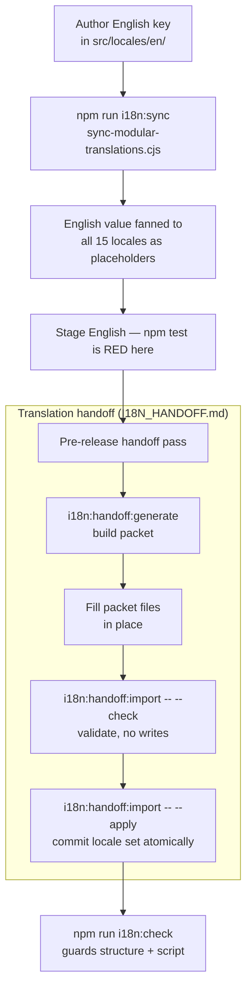

# Internationalization (i18n)

> **Last Updated: 2026-09-07**

## Contents

- [Overview](#overview)
- [Supported Languages](#supported-languages)
- [Directory Structure](#directory-structure)
- [Key Components](#key-components)
- [Redirection & URL Synchronization](#redirection--url-synchronization)
- [Synchronization Scripts](#synchronization-scripts)
- [Strict Validation](#strict-validation)
- [Wrong-script text](#wrong-script-text)
- [Bare English literals](#bare-english-literals)
- [Translation Handoff](#translation-handoff)
- [Adding a New Translation Key](#adding-a-new-translation-key)
- [Theme Naming Conventions](#theme-naming-conventions)
- [Pluralization](#pluralization)
- [Best Practices](#best-practices)
- [Keys reached indirectly — do not delete these by grep](#keys-reached-indirectly--do-not-delete-these-by-grep)
- [Adding a New Language (Step-by-Step)](#adding-a-new-language-step-by-step)

## Overview

KiwiCV uses a custom modular translation system. It does not use `i18next` or similar libraries. Translations are managed as static TypeScript objects and merged at runtime.

## Supported Languages

The app supports 15 languages: English (en), German (de), French (fr), Spanish (es), Italian (it), Portuguese (pt), Dutch (nl), Polish (pl), Russian (ru), Bulgarian (bg), Turkish (tr), Japanese (ja), Chinese (zh), Swedish (sv), and Ukrainian (uk).

## Directory Structure

`src/locales/`

- Each language has its own folder (e.g., `en/`, `de/`).
- Within a language folder, translations are split into modules (e.g., `editor.ts`, `common.ts`, `ai.ts`, `auth.ts`).
- `index.ts` in each folder aggregates all modules.
- `src/locales/index.ts` exports the final `locales` object containing all 15 languages.

## Key Components

- **`useTranslation` Hook**: `src/hooks/useTranslation.ts` provides the `t` function to access translation keys.
- **Section Labels**: Custom section labels can be overridden by users in `meta.theme.params.sectionLabels`.
- **Theme Translations**: Managed via `getThemeTranslations` in `src/components/preview/themes/shared.ts`.

## Redirection & URL Synchronization

The application ensures the URL and internal language state are always in sync:

1.  **URL Wins**: If a user visits a specific language path (e.g., `kiwicv.kiwicanopy.com/ja`), the app respects the URL. It updates the internal state (`appLanguage` in Zustand) to match the URL and persists this choice.
2.  **Root Redirect**: If a user visits the root `/`, the app detects the browser language and redirects to the appropriate subpath (e.g., `/de`).
3.  **Bot Exemption**: Bots are exempt from mandatory intro-tour redirects to ensure deep links can be indexed and previewed correctly. See [SEO.md](../code/SEO.md) for details.

## Synchronization Scripts

Maintaining 15 languages manually is error-prone. Use the provided scripts:

- `scripts/sync-modular-translations.cjs`: Adds a new key-value pair to all 15 locales. It resolves the path through the **TypeScript AST** (`updateModuleSource`), so quoted, numeric and hyphenated key segments work, and it sorts only the one object literal that received a new key.
- `scripts/sort-locales.cjs`: A global utility to alphabetically sort all keys in all translation files.
- `scripts/sync-changelog.cjs`: Synchronizes changelog entries across all 15 locales. It is the **only** changelog path. This page also listed a `scripts/translate-changelog.cjs` until 2026-08-09; that file was deleted and the line outlived it. Translated cells go back through `CHANGELOG_UPDATES` and a re-sync, per [CHANGELOG.md](CHANGELOG.md).
- `scripts/remove-keys.cjs`: A global utility to remove specific keys (e.g., `sync.old_key`) from all 15 locale files simultaneously. Essential for refactoring and cleaning up deprecated strings. It cuts the property through the TypeScript AST (`removeModuleProperty`), so a file with two exports or a `satisfies` clause works; a second export takes the catalog's `file:export` spelling (`themes:theme_translations.sections.x`).

- `scripts/find-bare-literals.cjs` (`npm run i18n:literals`): Finds user-visible English strings that never pass through `t()` — the one class the strict validation below is structurally unable to see.

## Strict Validation

Run `npm run i18n:check` before and after locale or translation-call changes.
The read-only check verifies:

- the locale registry, folder set, and module-file set are identical;
- every locale matches the English object structure;
- literal `t`, `tObject`, `tCV`, and `tCVObject` keys exist in English;
- non-literal calls use an explicitly registered prefix or callsite in
  `scripts/i18n/config.cjs`;
- plural `_one`/`_other` pairs, placeholders, and rich-text balance remain
  valid;
- no translated value contains a writing system its locale does not use (see
  below);
- every `scripts/i18n/handoff-catalog.cjs` row resolves in `src/locales/en/`
  **and** its stored `source` still equals the live English, **and** every
  shipped non-English value keeps the row's `protectedTokens` — the packet
  validator enforces them only on import, so this is what catches a hand edit;
- on a row listed in `ORDERED_PLACEHOLDERS` (`handoff-catalog.cjs`), the
  placeholders appear in the English order.

⚠️ **What the placeholder check guarantees.** `extractPlaceholders` is a sorted
set, so by itself the check proves the right _names_ are present, not that they
sit in the right slots: `{{proposed}} … {{original}}` swapped is a fluent
sentence stating the reverse. Order-equality everywhere is wrong — `ja`, `tr` and
`zh` reorder "X of Y" correctly — so a row with two or more placeholders must be
listed in `ORDERED_PLACEHOLDERS` (`tests/i18n/placeholder-order.test.cjs` fails
otherwise), and a locale that truly reorders is declared there with its exact
sequence. A reorder is therefore a reviewed fact: an undeclared one fails in the
importer and in `i18n:check`, and a declared one fails if it flips again. Keys
with no catalog row (`settings.export.pattern_tip`, the legal contact blocks) are
not covered.

`npm test` adds one more (`tests/i18n/handoff-catalog-coverage.test.cjs`): every
export that ships in `en` (`src/locales/en/index.ts`) — per export, so
`themes.ts`'s `theme_translations` counts apart from `themes`, and the
scan is held to that list so an export in an unparsed form cannot pass unseen —
has at least one catalog row, or an entry in `CATALOGUE_EXEMPT_EXPORTS` carrying the reason.
Only `changelog` is exempt (it has its own flow); `header`, `placeholders`,
`languages` and `examples` were catalogued in full on 2026-10-06. It
guards presence, not coverage — an export with one row and many uncatalogued
keys still passes, and nothing yet ratchets the uncatalogued count.

The last one exists because the catalog keeps a second copy of every English
string it sends to a translator, and nothing compared the two: a renamed English
value, a deleted catalog row and a row pointing at a nonexistent path all passed
`i18n:check`. It matters more than an ordinary duplicated constant because
`handoff-validation.cjs` treats `source` as a **protected field** at import time
— a stale row sends the wrong English out _and_ validates the reply against it.
Measured clean at the time it was added: 222 rows, 0 missing, 0 drifted, so
there is no exemption list.

`.lintstagedrc.cjs` runs `i18n:check` on any `src/locales/**/*.ts` **or
`scripts/i18n/handoff-catalog.cjs`** edit, so all of the above block at commit
time, not only in CI. The catalog is in that glob because the
locale↔catalog pairing breaks from either side.

## Wrong-script text

Everything else on this page checks _structure_: which keys exist, whether
placeholders balance. Nothing read the letters. So a value could be half
Russian and pass — which is exactly what had happened. Thirteen live strings on
2026-07-23 carried characters from the wrong writing system:

```
es  KiwiCV solo может acceder      →  puede
pl  pozostaлych dni                →  pozostałych
tr  Öнizleme                       →  Önizleme        (Cyrillic н for Latin n)
ja  アпиール                        →  アピール
ja  無料의静的ホスティング              →  無料の…          (Korean 의 for の)
zh  此请求의费用                      →  此请求的费用
zh  完全可选の                        →  完全可选的        (Japanese の for 的)
nl  Word-送信-documenten            →  Word-documenten
```

The pattern recurs and is worth recognising: a wrong-language particle or
homoglyph substituted for the right one. It is what a multilingual model
produces when it loses the target language mid-string, and it survives review
because a reader who does not know the language sees plausible text.

`scripts/i18n/check-scripts.cjs` attributes writing systems to locales and
fails on anything foreign. Two deliberate choices:

- **Latin is attributed to no locale.** Every locale uses it for `KiwiCV`,
  `GDPR`, HTML tags and URLs, so its presence proves nothing.
- **Han cannot separate `ja` from `zh`, but kana can**, since `zh` has none.
  That asymmetry is why the table maps each script to a _set_ of locales rather
  than giving each locale one expected script.

### What it does not catch

Wrong _script_, not wrong _language_. A Spanish string that is silently French
passes clean. So does a stray Latin word inside Chinese — the same q5 answer
above also opened a paragraph with the German `Legt`, found by reading, not by
the checker. This is a cheap high-precision guard, not proof of correctness.

### The baseline is empty and should stay empty

`script-contamination-baseline.cjs` exists because the guard was written before
the repairs came back from translation. All thirteen were fixed the same day,
so it ships empty.

Unlike `bare-literal-baseline.js`, where an entry records a defensible
decision, **an entry here records a bug**. Broken text is never defensible, so
the response to a new finding is to fix the string. `checkScripts()` fails on a
stale entry as well as an unlisted finding, so an exemption cannot outlive the
string it covers.

## Bare English literals

`i18n:check` validates keys that are looked up. A string written straight into
JSX calls nothing, so it is invisible to that check — and equally invisible to
the sweep that removed 192 dead `t('key') || 'literal'` fallbacks, which needed
a `t()` call to find them in the first place.

`npm run i18n:literals` finds them. It matches JSX text nodes, prose-carrying
JSX attributes (`alt`, `title`, `aria-label`, `description`, …), prose-carrying
object properties (`title`, `desc`, `message`, …), string literals rendered as
JSX children, and strings handed to a user-facing announcer such as
`addToast(...)`. In every one of those positions it walks the whole expression —
both arms of `cond ? 'a' : 'b'`, both sides of `||`/`??`, through parentheses —
because a one-level unwrap let `alt={name || 'User Avatar'}` ship;
`tests/lint/bare-literal-walk.test.mjs` pins that.

`tests/lint/bare-literals.test.mjs` runs inside `npm test` and fails on any
finding not frozen in `bare-literal-baseline.js`. **Adding a baseline entry is a
decision, not a formality**: the default is to route the string through
`src/locales/`, and every entry carries a `reason` saying why that would be
wrong. The list only shrinks — a stale entry fails the same test.

Two things this exists because of, both from 2026-07-21:

- The class was audited once by hand. The audit reported 45 findings and was
  **two short**: its announcer pattern matched `toast(...)` but not the
  `addToast(...)` this repository uses, so two live English strings in
  `Settings.tsx` were reported as clean and were found by an unrelated review a
  day later. A count produced once gets trusted afterwards as though it were a
  guard.
- Parse `.ts` as TS, not TSX. Reading a `.ts` file as TSX turns its generic
  parameters into JSX elements and produces confident nonsense.

Dynamic registrations must be narrow. Prefer a full prefix such as
`monetization.passes.` over a broad module prefix.

## Translation Handoff

Moved to **[I18N_HANDOFF.md](I18N_HANDOFF.md)**: who authors which locale, the
generate → translate → `--check` → `--apply` cycle, why translations move as
files rather than chat text, and why the packets are disposable and untracked.

**Agents author all fifteen, through the packet** (owner, 2026-09-07). This
reverses "author English only — German included", which held while a human
translator supplied the other fourteen. Derive each value from strings already
shipped in that locale; where one is genuinely beyond you, leave the English
placeholder and say so. See `.claude/rules/i18n.md` for the full ruling.

## Adding a New Translation Key

1. Open the relevant module in `src/locales/en/` (e.g., `common.ts`).
2. Add the key and its English value.
3. Propagate with `scripts/sync-modular-translations.cjs` (`npm run i18n:sync`),
   putting the **English** value in all 15 locales as a seed. The generator
   reopens any cell whose stored value equals the English source, and the packet
   is where the other 14 get their real values (agent-authored since
   2026-09-07).
4. Register the key in `scripts/i18n/handoff-catalog.cjs` and hand it over —
   see [I18N_HANDOFF.md](I18N_HANDOFF.md).
5. Reset `FIELDS_TO_SYNC` to `[]` afterwards (clear-before-add).

⚠️ **A new key makes `npm test` red, and it stays red until the translator round
lands.** `tests/i18n/untranslated.test.cjs` fails on any key holding the English
source in all fifteen locales — which is exactly what step 3 produces. Since
CI runs the full `npm test`, **a PR that adds a locale key cannot go green**
until the packet comes back and is imported. That is the check working:
the placeholder is a promise to translate, and this is what collects on it.

Plan for it rather than discovering it on the PR. Either land the key early
and hand the packet over while the rest of the work continues, or keep the
locale change in its own branch so the code beside it is not held hostage.
⚠️ Do **not** answer it with `untranslated-allowlist.cjs` — that file is for a
name or a URL that is genuinely the same in every language (a catalogued one goes
in `VERBATIM` in `handoff-catalog.cjs` instead), not for a string nobody
has translated yet. One task's own Definition of Done said "English
placeholder is fine"; it is not, and the branch could not be pushed.

Changelog entries are exempt — `CHANGELOG_UPDATES` keys are not scanned, which
is what makes "stage English as you go, translate once before release" work for
them and not for ordinary keys.

### Key lifecycle at a glance



For brand migrations, replace only the product name mechanically when the rest
of a sentence is unchanged. If wording changes semantically, author the English
source first, then take the other 14 through the packet — `/retranslate-key`,
not `sync-modular-translations.cjs`, which would leave the old sentence in
fourteen locales. Clear
`FIELDS_TO_SYNC` immediately after a successful run so the script does not
retain a stale payload.

## Theme Naming Conventions

To maintain a premium and consistent design identity, theme names (in `themes.names`) follow these rules:

- **Latin Alphabets**: For languages using Latin characters (English, German, French, Spanish, Italian, Portuguese, Dutch, Polish, Swedish, Turkish), theme names should **remain in English** (e.g., `soft: 'Soft'`, `elegant: 'Elegant'`). This avoids awkward semantic translations and maintains the theme's "brand" identity.
- **Non-Latin Alphabets**: For languages using different scripts (Russian, Bulgarian, Japanese, Chinese), theme names should be **transliterated** (phonetically) or translated semantically if it improves accessibility and fits the script's aesthetics.

## Pluralization

The custom `t` function supports simple pluralization based on the `count` variable.

1.  **Keys**: Define two keys in the translation object with `_one` and `_other` suffixes:
    ```ts
    items_improved_one: '1 item improved',
    items_improved_other: '{{count}} items improved',
    ```
2.  **Usage**: Call `t` with the base key and a `count` variable:
    ```tsx
    t('ai.status.items_improved', { count: 5 }); // Returns "5 items improved"
    ```

- The logic automatically appends `_one` (if count is 1) or `_other` (otherwise).
- If the suffixed key is missing in the current locale, it attempts to find it in the English fallback before falling back to the base key.

## Best Practices

- **Defensive Keys**: Always check if a key exists before using it, especially in themes.
- **Interpolation**: Use simple `{{variable}}` syntax for interpolation.
- **Consistency**: Ensure keys are consistent across modules.

## Keys reached indirectly — do not delete these by grep

⚠️ **A key can be referenced in four places, and only two of them are findable
by searching `src/` for the key.** Every locale-key cleanup this repo has got
wrong went wrong here, so check all four before deleting anything.

✅ **The good news first: the set of indirect call sites is complete, and
enforced.** `check-usage.cjs:42` errors on any `t()` whose argument is neither a
literal nor a registered dynamic prefix unless the exact `file` + `expression`
pair appears in `DYNAMIC_CALL_ALLOWLIST` — `unregistered dynamic call
t(<expression>)`. `i18n:check` runs it, so a new indirect call cannot reach main
unannounced. There is no hidden fifth way a key gets read.

That is why the AI improve flow needs no special handling, to answer the obvious
question: it reaches keys through two registered heads — ``t(`editor.sections.${id}`)``
and ``t(`languages.${targetLang}`)`` in `AIEditHeader.tsx` — and names everything
else outright.

### Rotating a list of phrases is safe; composing a key is not

The distinction is worth stating because the two look alike from the outside.
The AI loading screen cycles through seven messages, and someone reasonably
wonders whether it walks `ai.status.*` by name. It does not —
the `phases` array in `AIStatusProcessing.tsx` makes seven **literal** calls and rotates over the
resolved strings:

```tsx
const messages = [t('ai.status.analyzing'), t('ai.status.optimizing') /* … */];
```

**The values rotate; the keys are spelled out.** Every one is greppable, and
adding or removing a phrase is an ordinary edit. Do it this way.

The unsafe shape is the opposite: build the _key_ and then resolve it, as
`PricingPlanCard` does with `translationPath`. That is legitimate where an
inventory really is data-driven, but it costs the grep, so it has to be
allowlisted and listed above — and a key it reaches can never be found by
searching for its name.

| how it is reached                                 | findable by grepping the key?                                                                                                                                                                   |
| :------------------------------------------------ | :---------------------------------------------------------------------------------------------------------------------------------------------------------------------------------------------- |
| a literal — `t('editor.basics.title')`            | **yes**, the dotted key is in the source                                                                                                                                                        |
| a constant map — `t(RAIL_LABEL_KEYS[sectionKey])` | **yes**, the map holds the literal strings (`railSections.ts`, `composer/types.ts`, `EntryDiffRow.tsx`)                                                                                         |
| a template head — ``t(`legal.${slug}`)``          | **no**, only the head is literal. The 16 heads are registered in `scripts/i18n/config.cjs`'s `DYNAMIC_PREFIXES` and asserted against their call sites by `tests/i18n/dynamic-prefixes.test.cjs` |
| built into a variable first                       | **no**, and nothing recovers it. See below                                                                                                                                                      |
| `scripts/i18n/handoff-catalog.cjs`                | **no** — and this one is not in `src/` at all                                                                                                                                                   |

### The two that will catch you

⚠️ **A key composed into a variable.** `PricingPlanCard` builds
``const translationPath = `monetization.${category}.${plan.translationKey}` ``
and then calls `t()` on it, so **no part of `monetization.passes.30_days.description`
appears anywhere in the source.** Static analysis cannot see through it and
neither can a textual search. The whole of `monetization.passes.*` is reached this way. It is registered in
`DYNAMIC_CALL_ALLOWLIST`, which records _where the call is_ — not which keys it
protects, which is why this table exists.

⚠️ **The handoff catalog is a fourth reference site, outside `src/`.** Its rows
store the module and the path as **separate array elements** —
`['ai', 'composer_subtitle', 'Improve…', 'context']` — so the dotted key
`ai.composer_subtitle` exists nowhere as a string, and a scan of `src/` never
reaches it regardless. Deleting a key still listed there fails `i18n:check` and
`test:i18n` with _"key does not exist in English"_. That is the gate doing its
job, but it fires after the delete, not before.

### The 16 registered dynamic prefixes, and who reaches them

`blog.categories.` · `changelog.entries.` · `changelog.types.` ·
`editor.modules.languages.levels.` · `editor.modules.skills.levels.` ·
`editor.sections.` · `examples.` · `landing.proof.` · `landing.workflow.` ·
`languages.` · `legal.` · `monetization.ai_costs.` · `roadmap.items.` · `seo.` ·
`sync.providers.` · `themes.names.`

Do not read that list from here — it drifts. Generate it with
`dynamicPrefixCallSites()` from `scripts/i18n/translator-calls.cjs`, which
returns each prefix with the `file:line` that reaches it, and which the test
above asserts equal to `DYNAMIC_PREFIXES` in both directions.

## Adding a New Language (Step-by-Step)

To add a new language (e.g., `sv` for Swedish):

1.  **Scaffold Locale Folder**:
    - Create `src/locales/{code}/`.
    - Copy all `.ts` files from `src/locales/en/` to the new folder.
2.  **Translate Modules**:
    - Translate all strings in the new files.
    - **Tone**: Be friendly and direct ("close to the people").
    - **Branding**: Refer to the app as **KiwiCV**; avoid "We/Us".
    - **Type Safety (Mandatory)**: Every `.ts` file in the new locale folder **must** import and use the `Translations` type to ensure 100% parity with English.
      - _Example_: `export const ai: Translations['ai'] = { ... };`
    - **Critical**: Ensure `theme_translations` (in `themes.ts`) are accurate, as these drive the PDF/HTML headers.
3.  **Register Locale**:
    - In `src/locales/index.ts`, import the new locale and add it to the `locales` object.
    - Add the new language to the `LANGUAGES` array with its native label and flag.
4.  **SEO Integration**:
    - Add the new language code to the `supportedLanguages` array in `src/components/ui/SEO.tsx`.
5.  **Cross-Sync Language Names**:
    - Update `src/locales/{any}/languages.ts` for **all existing languages** to include the name of the new language in that specific tongue.
    - Update the new language's `languages.ts` to include localized names for all other supported languages.
6.  **Update Sync Scripts**:
    - Add the new language code to the `LOCALES` array in `scripts/sync-changelog.cjs`.
    - Update the documentation and examples in `scripts/sync-modular-translations.cjs` to include the new language code.
7.  **Final Polish**:
    - Run `scripts/sync-modular-translations.cjs` to ensure any recently added global keys are propagated.
