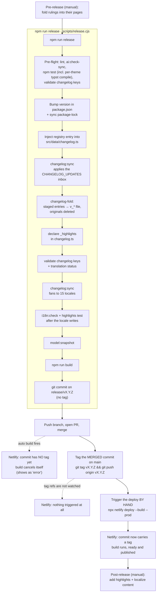

# Release Process

> **Last Updated: 2026-10-12**
> This document outlines the standard procedure for versioning and releasing new versions of KiwiCV.

## Contents

- [📋 Pre-Release Steps](#pre-release-steps)
- [🔢 Choosing patch, minor or major](#choosing-patch-minor-or-major)
- [🚀 The Automated Flow](#the-automated-flow)
- [🗺️ Release Flow at a Glance](#release-flow-at-a-glance)
- [🏷️ The tag is created after the merge, not by the script](#the-tag-is-created-after-the-merge-not-by-the-script)
- [✍️ Manual Post-Release Steps](#manual-post-release-steps)
- [⚠️ Safety Rules](#safety-rules)

## 📋 Pre-Release Steps

Before triggering the automated release workflow, you MUST complete these steps:

1. **Fold any durable ruling into the page that owns it.** There is no daily log — `.agent/wiki/daily/` was retired on 2026-08-29. A palette or salience decision goes to [DESIGN_LANGUAGE.md](../code/DESIGN_LANGUAGE.md), a control convention to [UI_PATTERNS.md](../code/UI_PATTERNS.md), a workflow to the relevant `ops/` page, and everything else to `git log`. Do the fold in the change set that earned it rather than saving it for release day.
2. **Clear/Align Task Instructions**: Confirm that the `temp_instructions/` directory is clean or correctly updated for handoff.
3. ~~**PDF compile smoke check** (manual)~~ — **automated on 2026-07-25**. `npm test` now compiles every theme's Typst output on a single-item, cover-letter-enabled fixture, using the app's own WASM compiler; the pre-flight `npm test` inside `npm run release` therefore covers it. No manual step remains. See [code/PDF_ENGINE_TYPST.md](../code/PDF_ENGINE_TYPST.md).

## 🔢 Choosing patch, minor or major

> Written down 2026-08-29, after 4.3.1 was nearly cut as 4.4.0. The rule had
> lived only as a pattern across past releases, so it had to be reconstructed
> from the entry types each one carried.

**Decide from the changelog entries the release will carry, not from the commit
prefixes.** `feat(ui)`, `feat(lint)` and `feat(editor)` are routinely palette,
guard or layout work on a surface that already existed. Conventional-commit type
answers "what kind of change is this diff", which is a different question from
"what does a user get that they did not have before".

| bump      | the test                                                                                                            |
| :-------- | :------------------------------------------------------------------------------------------------------------------ |
| **major** | A breaking or foundational change. The owner's call, never inferred.                                                |
| **minor** | The release carries at least one `feat_` changelog entry — a capability that did not exist in the previous release. |
| **patch** | Everything else: `fix_`, `ui_`, `perf_`, `refactor_`, `chore_`, `docs_`, `other_`, and dependency-only releases.    |

The history is consistent with this, which is why it is safe to state as a rule:

| release             | entries carried                 | bump  |
| :------------------ | :------------------------------ | :---- |
| 4.1.0, 4.2.0, 4.3.0 | each carried `feat_` entries    | minor |
| 4.2.1               | `fix_`, `perf_`, `ui_`          | patch |
| 4.2.2               | one `ui_` entry                 | patch |
| 4.2.3, 4.2.4        | `chore_dependency_updates` only | patch |
| 4.3.1               | three `ui_` entries             | patch |

⚠️ **A dependency update never makes a release minor**, however many packages
moved. 4.2.3 and 4.2.4 each carried nothing but `chore_dependency_updates` and
both are patches.

⚠️ **Curation happens before this decision, not after.** Entries are collapsed
into the story they tell (see [CHANGELOG.md](CHANGELOG.md)), and an entry the
owner drops is not in the count. 4.3.1 dropped `ui_plan_cards_accents` at
curation; had a `feat_` entry been dropped the same way, the release would have
become a patch — the count is of what ships, not of what was staged.

## 🚀 The Automated Flow

The primary release mechanism is the integrated release script:

```bash
npm run release [patch|minor|major] [-- --legal] [-- --update-deps]
```

### Options

- `--legal`: Triggers a legal re-consent prompt for all users by automatically updating the `LAST_LEGAL_UPDATE` timestamp in `src/constants/auth.ts` to the current date and time. Use this flag whenever the release updates the Terms of Service or Privacy Policy.
- `--update-deps`: Runs `scripts/update-minor.cjs` (minor dependency upgrades plus a license audit) **before** the pre-flight, so `npm test` runs against the upgraded tree rather than the one you started with.

### What the script does:

1.  **Pre-flight Checks**:
    - Runs `npm run lint` to ensure code quality.
    - Runs `npm run ai:check-sync` to verify prompt consistency.
2.  **Versioning**:
    - Increments the version in `package.json`.
    - Synchronizes `package-lock.json` via `npm install --package-lock-only`.
3.  **Registry Update**:
    - Injects a new entry into `src/data/changelog.ts` with the new version, today's date, and a formatted translation ID (e.g., `v_003_000_003`).
      3b. **Apply the `CHANGELOG_UPDATES` inbox** — `npm run changelog:sync`, so an inbox entry is in its version file, or a staged file, before anything below reads the release's entries.
    - ⚠️ The inbox used to be applied only at step 5, after the highlights were registered and the changelog validated. 4.5.0's inbox-staged highlight reached the version file but not `changelog.ts`, and rendered nowhere until it was declared by hand.
4.  **Fold the staged entries** (`scripts/changelog-fold.cjs`):
    - Merges every staged entry file — `feat_*.ts`, `ui_*.ts`, `highlight_*.ts`, anything that is not `index.ts`, `meta.ts` or `v_*.ts` — into this release's `v_*.ts`, in all 15 locales, and **deletes the originals**.
    - ⚠️ Without this step `npm run changelog:add` produced orphans: `changelog/index.ts` is rebuilt from `v_*` only, so a staged entry was written, translated fifteen times, and never read. `feat_heic_photo_upload` was staged before 4.2.4 and shipped announced by nothing.
    - It refuses rather than guesses: an entry file or a version file it cannot parse aborts the release instead of being deleted or overwritten.
      4a. **Declare the highlights** — every `_highlights.<id>` in the version file becomes `highlights: [{ id }]` on its `changelog.ts` entry. Each id still needs an icon in `src/data/changelogHighlights.ts`; step 5b halts the release until it has one.
      4b. **Validate the changelog** — key prefixes and translation status, now that the version file exists.
    - ⚠️ These ran at pre-flight until 2026-08-26, where the version file does not yet exist, so both returned early and validated **nothing** on every release. `check-untranslated.cjs` skips `changelog/` by design, so the translation gate was the only guard and it was dead.
5.  **Locale Scaffolding**:
    - Runs `npm run changelog:sync` to fan the entries across all 15 supported languages and rebuild each locale's `changelog/index.ts`.
      5b. **Check the locale writes** — `npm run i18n:check`, then `changelogHighlights.test.ts` again: the pre-flight `npm test` ran before the version file existed, so only this run can see an undeclared or icon-less highlight in the release.
6.  **Model Snapshot**:
    - Runs `npm run model:snapshot` to create a versioned example resume in `examples/`.
7.  **Production Build**:
    - Runs `npm run build`, which includes:
      - License checks.
      - TypeScript compilation (`tsc`).
      - Vite production bundle.

## 🗺️ Release Flow at a Glance



⚠️ **The two dashed branches are the point of this diagram.** Merging and
tagging each look like they ship the release and neither does: the automatic
build fires on the merge, when the commit still has no tag, and cancels; pushing
the tag afterwards triggers nothing, because Netlify watches branches and not
tag refs. Only the manual trigger at **N** puts the release in front of a user.

This diagram ended at "tag the merged commit" until 2026-08-29 and so described
a release that was tagged, green and not deployed.

## 🏷️ The tag is created after the merge, not by the script

`main` is a protected branch and takes pull requests only, so the release commit
cannot be pushed to it directly. The script therefore commits onto
`release/vX.Y.Z` (creating it if you started on `main`) and **does not tag**.

That is not just a convenience. The PR is **squash-merged**, so `main` receives a
_new_ commit with a different hash. A tag created before the merge would point at
an object that is not an ancestor of `main` — it would still push and still
resolve, and it would still be wrong.

⚠️ **Three things read those tags, and the first one is why this step is not
optional.**

1. **Netlify.** `netlify.toml`'s build `ignore` cancels a production build
   unless the commit carries an exact tag, so **tagging the merged commit is
   what deploys it.** A fix merged to `main` and left untagged is not in front
   of a single user, however green its CI was. This was listed nowhere until
   2026-08-29 and cost exactly that mistake — a merged fix described as shipped
   when nothing had built.
2. `git diff v<previous> -- package.json` in step 6.5, which decides whether a
   dependency changelog entry is injected.
3. Every "what shipped in X" question afterwards.

⚠️ Corollary: a tag moved forward to pick up a post-release fix **is** a
redeploy of that version, not just relabelling. That is a legitimate thing to
do on this repo — the alternative is cutting a version for a one-line fix — but
it means the tag no longer records the tree that first shipped under that
number. Prefer a new patch version when the difference would matter to anyone
reading back.

```bash
npm run release minor          # commits on release/v4.2.0, prints the next steps
git push -u origin release/v4.2.0
gh pr create --base main --title "chore(release): 4.2.0"
# …merge the PR…
git checkout main && git pull
git tag v4.2.0 && git push origin v4.2.0
# …then trigger the deploy: the tag push does NOT build anything.
npx netlify deploy --build --prod
```

⚠️ **That last line is not optional and is easy to miss.** Netlify triggers on
branch pushes, never on tag refs: the automatic build ran on the merge, when the
commit still had no tag, and cancelled itself. Pushing the tag afterwards
triggers nothing. Until a deploy is triggered by hand the release is tagged,
green, and **not in front of a single user**.

Confirm it landed with `npx netlify api listSiteDeploys` — the newest production
entry should be `ready` with `published: yes` on the merged commit. Entries
reading `error` / "Canceled build due to no content change" are untagged pushes
being ignored on purpose, not failures.

The script checks for the tag **on `origin` as well as locally** before it does
any work: now that tagging happens on whichever machine merged the PR, a local
`git tag -l` alone would let a second machine run a full build and only discover
the collision at push time.

For the same reason step 6.5 runs `git fetch --tags` first — a clone that never
fetched tags has none of them, and the dependency comparison would fall through
to its catch and inject a dependency changelog entry for a release that changed
no dependencies.

## ✍️ Manual Post-Release Steps

The automated script creates the "container," but you still need to provide the human-readable content:

1.  **Highlight extras**: the script declares each highlight id on the new `changelog.ts` entry (step 4a). Only optional metadata such as `desktopOnly` is added by hand.
2.  **Localize Content**: ⚠️ **Do this _before_ the release, not after.** Entries are staged with `npm run changelog:add` and translated in place in `src/locales/{lang}/changelog/<entry>.ts`; step 4 folds them into the version file, and step 4b refuses the release if the non-English values are still 1:1 English, `_highlights` blocks included. Before running, also confirm no `CHANGELOG_UPDATES` entry in `scripts/sync-changelog.cjs` still uses `stageEnglish`: step 4b halts on it only after step 3b has emptied the inbox and step 4 has deleted the staged files. Recover with `git checkout -- . && git clean -fd`, only on a tree that was clean before the run. There is nothing to fill in afterwards.
3.  **Final Sync**: If you use `scripts/sync-changelog.cjs` for bulk updates, run `npm run changelog:sync` again.
4.  **Git Commit**: these go up as an ordinary PR too — `main` takes nothing else.

## ⚠️ Safety Rules

- **Never skip pre-flight checks**: If the script fails during lint or AI sync, fix the issues before retrying.
- ⚠️ **Reset the tree before any retry.** The script is **not idempotent**: it bumps from
  whatever `package.json` currently says. A run that fails or is interrupted after step 1
  leaves the new version on disk, uncommitted — so retrying bumps a _second_ time and cuts a
  release whose changelog holds only the dependency line, the staged entries having already
  been folded into the previous number. `git checkout main && git status` and confirm a clean
  tree before running again. This is how 4.3.4 briefly became 4.3.5; nothing was pushed, so
  the branch was deleted and it was re-cut from a clean `main`.
- **Verify Build**: Always run `npm run preview` after a release to ensure the production bundle behaves as expected.
- **Double Check ID Pattern**: The translation ID MUST follow the `v_000_000_000` pattern (three digits per segment) to ensure compatibility with the sync scripts.
