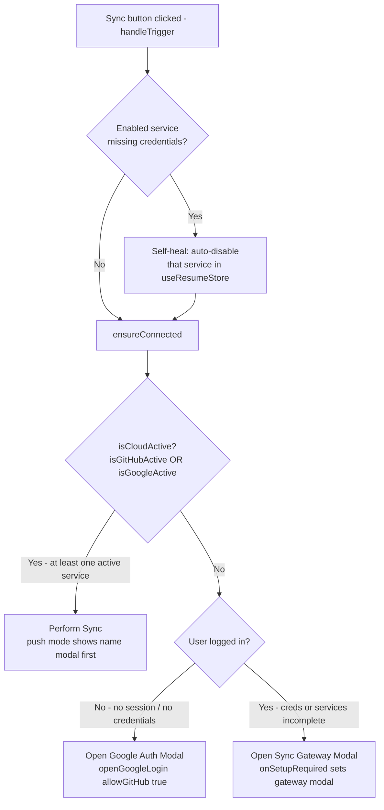
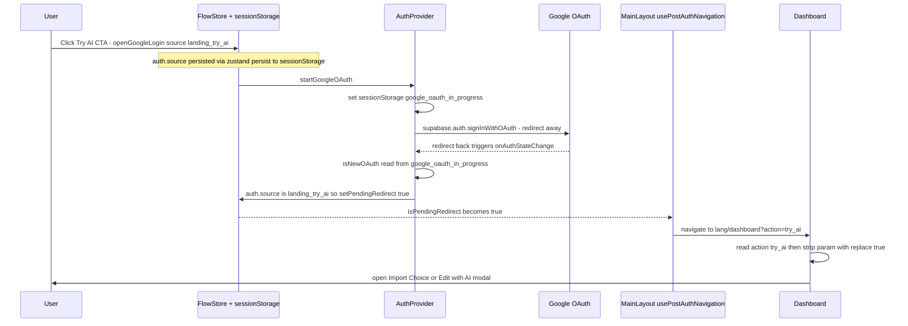

# Cloud Sync & Auth Flows

> **Last Updated: 2026-10-13**

## Contents

- [Overview](#overview)
- [1. Sync Button Trigger (`useSyncWorkflow.ts`)](#1-sync-button-trigger-usesyncworkflowts)
- [1b. The Export Run (`components/modals/export/`)](#1b-the-export-run-componentsmodalsexport)
- [2. Sync Gateway Modal (`CloudSyncGatewayModal.tsx`)](#2-sync-gateway-modal-cloudsyncgatewaymodaltsx)
- [3. Self-Healing Logic](#3-self-healing-logic)
- [3b. Change Detection (sync hashes)](#3b-change-detection-sync-hashes)
- [4. Unified Auth View (`AuthView.tsx`)](#4-unified-auth-view-authviewtsx)
- [4b. Restore and Manage — the CV library page (2026-08-09)](#4b-restore-and-manage-the-cv-library-page-2026-08-09)
- [5. Hierarchy & Z-Index](#5-hierarchy-z-index)
- [6. Modal Lifecycle & Auth Transitions](#6-modal-lifecycle-auth-transitions)
- [7. Multi-Root Backup Discovery](#7-multi-root-backup-discovery)
- [8. Auth Provider Robustness](#8-auth-provider-robustness)
- [9. Bulletproof Logout](#9-bulletproof-logout)
- [10. Domain Migration Gateway](#10-domain-migration-gateway)
- [11. Post-Login Redirection & Try AI Flow (`landing_try_ai`)](#11-post-login-redirection-try-ai-flow-landing_try_ai)

## Overview

The Cloud Sync system implements an intelligent onboarding and connection flow designed to minimize friction while ensuring all required permissions are met.

## 1. Sync Button Trigger (`useSyncWorkflow.ts`)

The `handleTrigger` logic (in `src/hooks/useSyncWorkflow.ts`, delegating to `ensureConnected` in `useSyncAuthGateway.ts`) determines the initial user experience when the sync/backup button is clicked.

| Condition                                                                                                                    | Action                      | Rationale                                                                         |
| :--------------------------------------------------------------------------------------------------------------------------- | :-------------------------- | :-------------------------------------------------------------------------------- |
| **No Credentials** (No GitHub PAT AND no Google Refresh Token)                                                               | Open **Google Auth Modal**  | Fastest path for new users. `allowGitHub: true` is set to provide an alternative. |
| **Credentials Exist but No Active Service** (Creds exist but all services are disabled in store, or permissions are missing) | Open **Sync Gateway Modal** | Allows user to perform a "one-click" activation or resolve permission issues.     |
| **At Least One Active Service** (Enabled in store + Has Creds + Permissions OK)                                              | **Perform Sync**            | Immediate action for connected users. (Shows name modal if in `push` mode).       |

### Decision Flow

The trigger lives in `handleTrigger` (`useSyncWorkflow.ts`), which self-heals then
delegates the three-way branch to `ensureConnected` (`useSyncAuthGateway.ts`).

`isGitHubActive` = `github.enabled && hasPat`; `isGoogleActive` =
`googleDrive.enabled && hasDriveCreds && hasDrivePermission === true`.

### Service "Active" Definition

A service is considered active if:

1. It is **Enabled** in the `useResumeStore`.
2. Valid **Credentials** are present (PAT for GitHub, Refresh Token for Google).
3. **Permissions** are granted (specifically `hasDrivePermission !== false` for Google).

---

## 1b. The Export Run (`components/modals/export/`)

The export dialog does **not** go through `performSync`. That path opens a blocking
`confirm({isLoading:true})` and then a success `ConfirmModal` at `z-[200]`, both of which
would sit on top of the dialog whose whole point is to report inside itself. `performSync`
is untouched and still serves the Backup button.

### One trigger, N destinations

`useExportRun` runs in two acts.

1. **Build once.** `buildExportArtifacts` (`src/hooks/export/buildExportArtifacts.ts`) produces
   the PDF, the HTML and the project snapshot, and is the **single acquisition point** for
   them. The same three steps were once written out in `useDownloadWorkflow`,
   `githubSync` and `googleDriveSync`, all driving the one module-level Typst worker that
   handles a single request at a time — so a run targeting ZIP + GitHub + Drive would have
   paid the slow compile three times, serially. `useCloudSync` now builds it once for a
   `full` variant and passes it in `SyncParams.artifacts`; each provider keeps a fallback
   build so it still works when called alone.
2. **Sequence.** Destinations run **serially** in row order through
   `DESTINATION_ADAPTERS` (`src/hooks/export/destinationAdapters.ts`). Serial, not
   parallel: the ZIP's `saveAs` must not fire while a network push is mid-flight, and the
   per-row progress is only legible with one active row. `runDestination` never throws, so
   one failure leaves the others intact and the loop never breaks.

Afterwards the trigger relabels to **Retry** over exactly the failed ids; succeeded rows lock
with a check. A failure in act 1 fails every selected row with the same reason and surfaces
the "switch the PDF off under Change" recovery, which is why the format choice stays
reachable. One `EXPORT_PERFORMED` event and one toast per run; `syncVersion()` once, not once
per destination. `DialogFrame busy` blocks Escape while in flight. ⚠️ **The dialog closes on its
own only when every destination succeeded** (owner, 2026-10-24, #34): its success toast stays
10 s (`ALL_OK_TOAST_MS`) and carries the result. A partial or failed run keeps the dialog open on
the per-destination report and Retry.

| Destination    | Adapter                                     | Available when                                 |
| :------------- | :------------------------------------------ | :--------------------------------------------- |
| `zip`          | `saveArtifactsAsZip`                        | always                                         |
| `github_repo`  | `handleSync('full', ['github'], 'sync')`    | `github` is `active` or `connected_disabled`   |
| `google_drive` | `handleSync('full', ['google_drive'], …)`   | `googleDrive` is `active`/`connected_disabled` |
| `github_pages` | `handleSync('hosting', ['github'], 'push')` | same as `github_repo` — Pages is GitHub-only   |

`'sync'` mode also refreshes the master `backups/{lang}/resume.json`, which is what the export
has always done. Publishing runs as `'push'` so selecting it alongside the repository
destination does not push the same snapshot twice.

### Per-run choice vs background preference

`useExportDestinations` reads availability from `useProviderStates` — never a second
`localStorage.getItem('github_pat')`. A **`connected_disabled`** provider (credentials
present, sync switched off in Settings) still gets a row, defaulted off, and
`CloudSyncOptions.providers` runs it without writing to `sync.*.enabled`. Those flags are
the _background backup_ preference; the dialog's toggles are a per-run choice, and
conflating them would let an export silently re-enable the Backup button's behaviour.

A Drive handshake still in flight (`checking`) renders the row inert rather than absent. A
persisted destination whose provider has gone is hidden and excluded from the run, but keeps
its stored flag so reconnecting restores it. Preferences live in
`BRAND_STORAGE_KEYS.exportPreferences`, per device, version-tagged and discarded whole on any
mismatch.

`activeSyncModal` is a single enum, so opening the cloud gateway unmounts the dialog.
`exportDraft.ts` holds the typed name fields at module scope across that detour and across
the Google OAuth redirect within the tab; it is cleared on an explicit Cancel or a fully
successful run, never on a failure.

---

## 2. Sync Gateway Modal (`CloudSyncGatewayModal.tsx`)

The Gateway acts as a central hub for managing connections and resolving "Action Required" states.

### Permission Handling (Google Drive)

If Google Drive is connected but missing the required OAuth scopes (`hasDrivePermission === false`):

- **Visuals**: The card displays an amber **"ACCESS REQUIRED"** badge and an alert icon on the service icon.
- **Interaction**: Clicking the card opens the `DrivePermissionModal` directly to resolve the scope gap.

### Setup Redirection

When a user clicks "Setup" for Google Drive from the Gateway:

- The **Google Auth Modal** is opened with `allowGitHub: false`.
- This modal utilizes the **`AuthView`** component in `modal` variant to provide a consistent value proposition and secure login path.

---

## 3. Self-Healing Logic

To prevent stale UI states, `handleTrigger` performs a "Self-Heal" check on every trigger:

- If a service is marked as **Enabled** in the store but **Credentials** are missing, the service is automatically **Disabled** in the store before any modals are shown.

---

## 3b. Change Detection (sync hashes)

A sync that finds the store unchanged since its last push reports `alreadySynced`
and pushes nothing. The comparison value is `getResumeHash` (`src/utils/hash.ts`):
SHA-256 of the serialized store, lowercase hex, kept in localStorage under the five
keys `ALL_SYNC_HASH_KEYS` lists (`services/storage/syncHashes.ts`). A full push
stores `fullPushStamp(digest, backupFileName)`, a digest of both: the file name
carries the company and position applied to.

- ⚠️ **It must stay a one-way digest.** Those keys outlive the resume they
  describe — across a removed pass-through block, a signed-out account, a
  cleared editor — so an encoding of the store there is a second, unmanaged
  copy of it. Earlier builds stored reversible base64, and needed a hash wipe
  plus a sync-in-flight lock just to remove one pass-through block.
- `getResumeHash` is async (`crypto.subtle`), so both callers — `useCloudSync`
  and `useCloudRestoreAction` — await it, inside their error handling.
- `discardLegacySyncHashes`, run from `main.tsx` at startup, removes any value
  under those keys that is not a digest. A discarded or stale value costs at
  most one redundant push; nothing reads a stored value except to compare it.
- A tab still open on an older build can write a legacy value until it reloads
  on the new one. That costs one extra push, and the next startup discards it.
- ⚠️ **A hash belongs to the connection that wrote it.** Every path that
  drops a credential resets that provider's hashes: `clearGoogleDriveCreds()`
  (reached by `disconnectGoogleDrive()`, sign-out, the account-switch guard and
  an unusable-grant handshake), `clearGitHubCreds()` (via `disconnectGitHub()`),
  and a GitHub Connect (`useGitHubConnect` calls `resetGitHubSyncHashes()`). That
  is not enough on its own: a writer still awaiting the network would write its
  hash afterwards, and the next connection — perhaps another Google account or
  repository — would report `alreadySynced` and upload nothing.
  So no hash is written with `localStorage.setItem` directly. Each writer
  snapshots the connection before its first await and writes through it:
  `googleDriveConnection().writeHash` (`googleStorage.ts`, compares the refresh
  token; the owner stamp never changes without it) and
  `githubConnection().writeHash` (`githubStorage.ts`, compares token _and_
  repository, since a Connect can keep the token and switch repositories). The
  writers, all of them:
  - `performGoogleDriveSync` — `GOOGLE_LAST_SYNC_HASH_KEY`,
    `GOOGLE_LAST_FULL_PUSH_HASH_KEY`;
  - `performGitHubSync` — `GITHUB_LAST_SYNC_HASH_KEY`,
    `GITHUB_LAST_FULL_PUSH_HASH_KEY`, `GITHUB_LAST_HOSTING_HASH_KEY`;
  - `useCloudRestoreAction` — the restored source's `*_LAST_SYNC_HASH_KEY`,
    snapshotted before the download.

  A new writer goes through the same helper.

---

## 4. Unified Auth View (`AuthView.tsx`)

The `AuthView` component is the single source of truth for authentication UI and logic. It enforces:

1. **Self-Contained State**: Manages `acceptedTerms`, `acceptedPrivacy`, and `isSubmitting` internally.
2. **Standardized Legal Compliance**: Ensures that users cannot click the Google Login button without explicitly accepting the Terms and Privacy Policy.
3. **Dual-Pane Consistency**: Maintains the "Marketing Benefits" pane across all entry points (Login Page, Modal, and Inline Account state).

---

## 4b. Restore and Manage — the CV library page (2026-08-09)

**There is no backup-selector modal.** `CloudBackupSelectorModal` and its
`cloud-backup-selector/` directory were deleted; every entry point that used to
open it now goes to **`/:lang/cvs`** (`src/pages/CvLibraryPage.tsx`, feature code
in `src/features/cv-library/`).

| Entry point                                                 | Behaviour                                                                                                                                                                                       |
| :---------------------------------------------------------- | :---------------------------------------------------------------------------------------------------------------------------------------------------------------------------------------------- |
| Sidebar "My CVs" (`layouts/sidebar/navigation.ts`)          | A real path, so it gets the active pill and `aria-current`. The synthetic `?action=manage_cvs` is gone, and so is the `DashboardHeaderActions` effect that consumed it.                         |
| Sync Gateway with `syncGatewayTarget === 'manage'`          | "Start sync" closes the gateway and navigates to `/:lang/cvs`.                                                                                                                                  |
| GitHub just connected (`useGitHubConnect.ts`)               | Navigates to `/:lang/cvs?source=github` **after** `onClose()`. The old fire-and-forget discovery raced the modal teardown.                                                                      |
| Google post-login restore (`GooglePostLoginRestore.tsx`)    | Seeds `useCvLibraryStore` from the backups `useAuth` already fetched, then navigates to `/:lang/cvs?source=google_drive` — no second Drive call.                                                |
| Language switch finding >1 backup (`checkAndRestoreLocale`) | Offers "Open My CVs", hands over the discovery it just paid for, and navigates with `?language=<locale>`. The **single**-backup branch is unchanged: it still restores through a plain confirm. |

`useCloudRestorePrompt` no longer opens anything. It exposes
`checkAndRestoreLocale`, `discoverBackupsForRoute` (seeds the store, reports
whether there is anything to show) and `handleDelete`. The restore itself moved
verbatim to `hooks/cloud/useCloudRestoreAction.ts`, so the page and the language
switch run one implementation.

### Discovery cost, and why the page caches

`discoverBackups(undefined)` was always the all-locales branch — the modal's
language dropdown was a _display_ constraint, not a fetch one. GitHub costs
**2 + L + F** requests (two root listings, one per locale directory, and one
`getLastCommit` per JSON file, which dominates); Google Drive costs **1**, via
the server-side `discover-backups` action in §7. The page therefore renders a
cache younger than five minutes and offers an explicit Refresh. Collapsing
`getLastCommit` into one directory-wide `listCommits` is a real improvement and
belongs in its own issue.

### Provider failures are reported now

`discoverBackups` returns `attempted` and `failed` alongside `foundBackups`.
Both providers used to swallow their error into a `console.warn` and let the
caller say "no backups found", which is a lie when a token has expired. Every
attempted provider failing is `status: 'error'` with a Retry action; one of two
is a dismissible warning above real results.

---

## 5. Hierarchy & Z-Index

To ensure modals stack correctly when triggered sequentially:

- `GoogleAuthModal`: `z-[150]` (Highest priority, covers everything)
- `ConfirmModal`: `z-[200]` / `z-[130]`
- `GitHubSyncModal`: `z-[90]` (Sits above the gateway modal)
- `CloudSyncGatewayModal`: `z-[60]` (Positioned above the resizable divider at `z-50`)

---

## 6. Modal Lifecycle & Auth Transitions

To allow already-authenticated users to configure GitHub or recover Drive permissions, the `MainLayout.tsx` implements a transition-aware closure policy:

- **Auto-Close**: Auth modals (`GoogleAuthModal`, `GitHubSyncModal`) are only automatically closed if the user state transitions from `null` to `non-null` (fresh login) OR if required permissions (Google Drive) are granted.
- **Manual/Explicit Closure**: If a user is already logged in, configuration modals remain open until the user manually completes the setup (e.g., successful GitHub PAT entry) or cancels/backs out.
- **Back Button Logic**: The "Back" button in the GitHub modal intelligently determines its behavior:
  - If accessed via the initial login selection, it returns to the selection screen.
  - If accessed directly from Settings or the Sync Gateway, it simply closes the modal (returning the user to their previous context).
- **Persistence**: Modal states are persisted in `sessionStorage` to survive the OAuth redirect flow used by Google.

---

## 7. Multi-Root Backup Discovery

To minimize network traffic and API usage during the post-login phase, the system uses a server-side discovery mechanism for Google Drive:

- **Action**: `discover-backups`
- **Logic**: One frontend request discovers metadata below canonical `KiwiCV`
  and legacy `CVCanvas`. The retired `CV-Canvas` root is not queried.
- **Identity**: Every result carries its Drive file ID and `driveRoot`, so
  same-name files remain independently restorable and deletable.
- **Writes**: Uploads and folder creation are accepted only below `KiwiCV`.

### Implementation Detail: Modular Netlify Function

To maintain the 300-line limit and improve maintainability, the Google Drive logic is decoupled:

- **`netlify/functions/lib/google-drive.js`**: Authentication, folder creation,
  and upload helpers.
- **`netlify/functions/lib/google-drive-discovery.js`**: Read-only multi-root
  metadata discovery.
- **`netlify/functions/google-drive-sync.mjs`**: Request routing and canonical
  write guards.

---

## 8. Auth Provider Robustness

To prevent UI lock-ups and handle race conditions during account creation, the `AuthProvider` implements several safety guards:

### Loading State Safety (finally block)

The `onAuthStateChange` listener is wrapped in a `try...finally` block to ensure `setLoading(false)` is always called. This prevents the "Loading Lock" where buttons remain disabled if an error occurs during the profile fetch or metadata sync phase.

### Robust Profile Fetching (Retries)

The `fetchProfile` function implements a retry mechanism (default: 3 attempts) with a 1-second delay between attempts. This specifically handles the race condition where a user signs in for the first time, but the database trigger hasn't finished creating the profile row yet.

### Session Flag Cleanup

Auth methods (`signInWithGoogle`) use `try...catch` blocks to ensure that temporary session flags (like `google_oauth_in_progress`) are cleared even if the OAuth flow fails to initiate.

⚠️ **`google_oauth_in_progress` is not a one-shot.** A plain sign-in clears it
on the first session event after the redirect; a Drive flow clears it only after
a handshake answers. And the sign-in
modal's and account page's safety effects remove it whenever loading ends with
no user, which the 6-second loading timeout can make happen before the session
arrives. Nothing that must fire exactly once per sign-in may key on it — the
writing sample has its own marker (§9).

#### How a Drive return ends

Every return that asked for Drive ends, whatever the handshake says. A flag
left set is not inert: a reload within ten minutes re-checks the stored token
with the consent retry allowed, and a token revoked meanwhile redirects to
Google with nobody pressing anything.

| Google sent back                 | Checked         | Ends by                                                                                                                                          |
| -------------------------------- | --------------- | ------------------------------------------------------------------------------------------------------------------------------------------------ |
| a fresh `provider_refresh_token` | the fresh token | usable: `finishOAuthReturn` (sync on, flags cleared). Dead: settled first, sync stays off. Refused: flags dropped. Blip: see below               |
| no fresh token, one stored       | the stored one  | not stamped for this account: flags dropped. Usable: `finishOAuthReturn`. Dead: `settleDeadDriveReturn`. Refused: flags dropped. Blip: see below |
| no fresh token, none stored      | nothing         | within ten minutes of leaving: the one-shot `prompt=consent` retry. Later (a stale return, e.g. Back into a cached page): flags dropped          |

**A blip is not a refusal.** An `undetermined` verdict — a network
failure or a 5xx — finishes the return, so the user's Connect is not undone,
but only while the checked token is still the stored one: an orphaned check
(sign-out, user switch) also resolves `undetermined`, and drops the flags instead.
Sync is then on with `hasDrivePermission` still `null`, which every sync path
treats as inert. Because the next auth event can be an hour away, the return
re-checks the token about 5, 20 and 65 seconds later (one chain per return,
started by whichever event ends it). A chain that ends without a usable verdict
— Drive never answered, or the token was signed out or replaced meanwhile —
removes `PENDING_GOOGLE_RESTORE_KEY`, so a much later passing check cannot pull
the user into the restore prompt. If all three fail, the card stays "checking"
until the next auth event; a toast with Retry is #2.

The middle row is the usual one: a Connect over a stored credential omits
`prompt=consent`, and Google then issues no refresh token. On an OAuth return
`INITIAL_SESSION` and `SIGNED_IN` both reach the stored-token check, and
`checkDrivePermission` dedupes the second; it hands that caller the first
check's pending verdict, so neither event can finish the return early. One
check runs at a time, held in a single `driveCheckRef`
(`{ token, pending, verdict }`, cleared by every reset): while `pending`, a call
for another token waits for the running check and then checks again, so no
caller ever receives a verdict about nothing. After a supersede the entry
carries the replacing token, whose check the loop is running. A check a reset
orphaned writes no state and resolves `undetermined`, which the blip rule above refuses to finish on.

The verdict is the handshake's alone, and `pending` ends when the handshake
settles. Backup discovery starts after that, outside the pending window — it
has no timeout, so a waiting check must not wait on it — and writes its result
only while its entry is still current. Its failure leaves `availableBackups`
unknown (the restore prompt then discovers for itself) and never turns a passed
handshake into `undetermined`.

The middle row finishes only against a token stamped for the signing-in
account. An unstamped one predates owner tracking and may belong to someone
else on a shared browser profile, so it drops the flags instead, and
`startGoogleOAuth` treats it as no credential: the next Connect sends
`prompt=consent`, and the fresh token it returns is stamped.

### Only a Drive flow holds a Google credential

Owner ruling, 2026-10-12, for data minimisation: the privacy policy says
sign-in data reaches no server unless an optional feature is used. So:

- A plain sign-in sends neither `access_type=offline` nor `prompt=consent`. It
  stores no refresh token, and it sends none to `google-drive-sync`. Only a flow
  started with `requireDrive` saves `provider_refresh_token` and handshakes it.
  A session restore still handshakes a credential that is already stored.
- Connecting Drive later still yields a refresh token: with no credential
  stored, the Drive flow sends `prompt=consent` (see the consent comment in
  `startGoogleOAuth`).
- A stored credential is never used unasked. The library's provider-less
  discovery (`useCloudDiscovery`) queries Drive only when Drive sync is on and a
  credential is stored, or when the caller names `google_drive`. Sync on is the
  consent signal. The handshake is deliberately not part of the gate: on a cold
  load of My CVs it has not answered yet, and `useCvLibrary` caches that first
  pass for five minutes, so gating on it hid Drive backups whenever GitHub was
  also active.

#### Which handshake failures discard the credential

The handshake's answer is a code, and only two codes prove a credential can
never work. `google-drive-sync` sets them; `googleDriveService.handshake`
surfaces them; `UNUSABLE_DRIVE_CREDENTIAL_ERRORS` in `constants/cloud.ts` names
them.

| Code                 | Set when                                                                                                                      | Credential                   | `hasDrivePermission` |
| -------------------- | ----------------------------------------------------------------------------------------------------------------------------- | ---------------------------- | -------------------- |
| `INSUFFICIENT_SCOPE` | Drive answers 403 with reason `insufficientPermissions` or `ACCESS_TOKEN_SCOPE_INSUFFICIENT` (200 response, `success: false`) | cleared, whatever sync state | `false`              |
| `INVALID_GRANT`      | The token exchange fails with `invalid_grant`: revoked or expired (HTTP 400)                                                  | cleared, whatever sync state | `false`              |
| `UNAUTHORIZED`       | Any other Drive 401/403 (quota, Workspace policy, unreadable body), a function-level 401/403, or any other `success: false`   | kept                         | `false`              |
| anything else        | Network failure, any other token-exchange failure (`invalid_client`: a 500), any other non-OK                                 | kept                         | `null`, retried      |

- The credential is cleared only if it is still the stored one. If a newer one
  replaced it while the check was in flight, the verdict is about a token no
  longer held: nothing is cleared, and the newer credential is checked instead.
- `deriveGoogleDriveState` reports `permission_required` for
  `hasDrivePermission === false` and for a missing credential alike, so
  clearing does not change what the user sees. It changes what Reconnect sends:
  with nothing stored, `prompt=consent`, which is what a dead or no-scope grant
  needs.
- Clearing during a pending Drive return (`google_oauth_require_drive` is
  `'true'`) settles that return at once (`settleDeadDriveReturn`):
  - **The user just pressed Connect** and the dead credential was the stored
    one (Google sent no fresh token): it retries once with `prompt=consent`
    right away, setting `google_oauth_consent_retry` exactly as the existing
    retry does. It counts as just pressed when `google_oauth_in_progress` is
    under ten minutes old, because that flag can outlive a Drive return in the
    tab.
  - **Every other case** (the retry already spent, a stale return, or the dead
    token being the fresh one the user just authorized, where re-asking would
    bounce them straight back) removes `google_oauth_in_progress`,
    `google_oauth_require_drive` and `PENDING_GOOGLE_RESTORE_KEY`. Otherwise the
    consent retry, which fires on Drive-return flags plus no credential, would
    redirect to Google on a later token refresh or refocus with no user action.
    It also keeps a refused connect from switching sync on.
- This is what removes the no-scope token an earlier plain sign-in saved, before
  the ruling above: it is handshaked once more on the next restore, answers
  `INSUFFICIENT_SCOPE`, and goes.

---

## 9. Bulletproof Logout

To ensure a snappy, reliable, and "dev-proof" logout experience, the `signOut` flow implements a multi-stage cleanup strategy that prioritizes immediate UI responsiveness.

### Immediate State Purge

Upon clicking "Sign Out", the `AuthProvider` immediately (synchronously) clears all internal state variables (`user`, `session`, `profile`, `hasDrivePermission`, `availableBackups`). This forces an instant UI transition to the signed-out state, bypassing the wait time for the server-side Supabase sign-out call.

### Localized UI Feedback

- **Loader**: Instead of a global full-page loading lock, the logout process uses a localized `isSigningOut` state in `AccountPage`. This allows the "Sign Out" button to show a spinner while the actual cleanup runs in the background.
- **Toast**: Success feedback is provided via `addToast` (localized as `auth.success_logout`) once the Supabase call completes.

### Explicit Session Cleanup

To prevent stale flags from interfering with subsequent logins, the logout flow explicitly removes:

- `PENDING_GOOGLE_RESTORE_KEY`
- `google_oauth_in_progress`
- `consent_terms_given`
- `consent_privacy_given`

### The writing sample is bound to its account

The cover-letter writing sample (`kiwicv-cover-letter-style`) is personal text
and leaves with the session: `signOut()` and the `SIGNED_OUT` branch clear it.
⚠️ **Those two are not enough.** A stored session whose refresh is refused at
startup reaches a listener that subscribed after the refusal as
`INITIAL_SESSION` with no session — never `SIGNED_OUT` (measured against the
installed supabase-js in `providers/__tests__/supabaseLateSubscriber.test.ts`).
So every write is stamped with the signed-in user id, and
`bindCoverLetterStyleToUser` (`services/storage/coverLetterStyleStorage.ts`)
clears a sample stamped for another user at any session event. While signed out,
a stamped sample reads as empty.

⚠️ **An event name cannot say "fresh sign-in".** Measured in the same test file:
an OAuth return (implicit flow, the app's) opens with `INITIAL_SESSION` and only
then `SIGNED_IN`, and a plain reload sends `SIGNED_IN` — re-sent on every tab
focus. So an unstamped sample (written signed out, or stored before the stamp
existed) is cleared only by the first session bind after an OAuth sign-in
started — which is how another account arrives after a silent exit — and
adopted as the session user's on any other event. Clearing it everywhere would
have cost every existing user their sample once.

That sign-in is marked by its own sessionStorage key,
`kiwicv-cover-letter-style-fresh-sign-in`, never by `google_oauth_in_progress`
(§8 says why). `startGoogleOAuth` sets it beside that flag; the first session
bind consumes it, whatever the event; `signOut()` and a sign-in that fails to
start remove it. It lives at most until the next session arrives in that tab.

### Data Preservation Policy

- **Local Data**: Resumes in `useResumeStore` are **not** cleared on logout. The app follows a "local-first" philosophy where data preservation is the default.
- **GitHub PATs**: device-bound by default, opt-in removal at sign-out (owner, 2026-10-13).
  The token is not part of the KiwiCV account and GitHub sync works signed out, so it survives
  `signOut()`. But a normal sign-out also clears the Drive owner stamp, so the account-switch guard
  in `AuthProvider` cannot fire for the next person on the same browser — the prompt is the only
  thing standing between them and the first person's token. Every user-initiated sign-out
  (`AccountPage`, the profile-missing dialog in `PricingDialog`) goes through `useSignOutFlow`,
  which, **only when a token is stored**, raises the three-way `confirm()`: _Remove GitHub and sign
  out_ / _Keep GitHub and sign out_ (focused, the default) / dismiss = stay signed in. It is a
  `confirm()` rather than a checkbox because there was no sign-out dialog to add one to, and this is
  the same three-way shape the GitHub and Drive switch-off prompts already use. Sessions that end
  without the user (`SIGNED_OUT` from expiry or another tab) are not asked.
- **Account deletion removes the GitHub token by default** (owner, 2026-10-13). Deletion is
  the strongest "I'm leaving" signal, so `DeleteAccountModal` shows _Also remove the GitHub
  connection from this device_, **only when a token is stored** and **ticked by default**. It is a
  checkbox here, not the sign-out `confirm()`, because this flow already is a dialog. Ticked, it runs
  `disconnectGitHub()` only after `delete-user` succeeds — a failed deletion leaves the user signed
  in and syncing, so their token stays. Unticked keeps the token, as `signOut(false)` always has.
- **Disconnect is never behind the switch.** The GitHub card shows **Disconnect GitHub** whenever a
  token is stored, `connected_disabled` included; it pushes nothing. Disconnect, the switch-off
  prompt's _Yes_ and the sign-out prompt's _Remove_ and `AuthProvider`'s account-switch guard all run one `disconnectGitHub()`
  (`hooks/sync/disconnectGitHub.ts`): token, stored repository and sync hashes go, and the sync
  config drops `repo` too, since rehydration writes a store-held repo back to `github_repo`. The
  copy promises "repository settings", so a repo left in the config would make it untrue. On
  success the Disconnect button unmounts, and the dialog returns focus to the card's Edit/Set up
  button through `restoreFocusTo`. Before the Disconnect button existed, the only path to `clearGitHubCreds` was switching sync _off_,
  which a user who had once chosen "No, keep credentials" could reach only by switching it on —
  and on can push. Withdrawing consent must not require granting it again (GDPR Art. 7(3)).
- **The same holds for Drive.** The Drive card shows **Disconnect Google Drive** whenever
  `hasStoredGoogleDriveCreds()` is true — `connected_disabled` included, and `permission_required`
  too, beside **Grant permission** (an `UNAUTHORIZED` handshake keeps the credential) — and never
  enables sync. It and the switch-off prompt's _Disconnect and remove access_ run one path: the
  confirm stays open and busy (`closeOnConfirm: false`), `disconnectGoogleDrive()`
  (`hooks/sync/disconnectGoogleDrive.ts`) turns sync off, revokes at Google, then clears token,
  owner stamp and hashes (a sync still in flight writes none afterwards, §3b), and the confirm
  closes. The revoke is best effort and gives up after
  `REVOKE_TIMEOUT_MS` (10 s), since a busy confirm cannot be cancelled. A failed revoke still
  clears — from KiwiCV's side Drive is disconnected — but the authorization may outlive the token
  at Google, so the function resolves `false` and the success toast ("no longer has access") is
  swapped for a warning (`sync.disconnect_drive_revoke_failed`) naming
  myaccount.google.com/connections; the toast has no action slot, hence the URL in text. A throw
  closes the confirm with `common.error_occurred`. Focus lands on the card heading (`tabIndex={-1}`),
  never on Grant or the switch, where the next Enter would start a new authorization. Sign-out and
  the account-switch guard clear the Drive token without revoking; that is unchanged.

---

## 10. Domain Migration Gateway

Browser storage is origin-scoped, so the legacy (pre-rebrand) hosts cannot
silently transfer local resume data to `kiwicv.kiwicanopy.com`.

### The Challenge

`localStorage` is scoped to the origin (domain). Users on the old Netlify domain lose access to their resumes when redirected to the new `.app` domain.

### The Implementation

1. Explicit host classification in `src/config/brand.ts` shows
   `MigrationGateway` on two host classes only: the legacy domains
   (`cvcanvas.app`, `www.cvcanvas.app`) and the opt-in local preview host.

   **To see the gateway locally: `http://migration.localhost:5173/`.** Browsers
   resolve `*.localhost` to loopback per RFC 6761 on every OS, so no hosts-file
   entry is needed; the system resolver may not, which only affects non-browser
   clients such as `curl` on Windows. Vite allows `*.localhost` without an
   `server.allowedHosts` entry.

   ⚠️ **`migrationPreviewHostnames` is checked _before_ the development branch,
   so it must never hold an address a dev server prints.** It once held `127.0.0.1`
   — the exact URL `npm run dev` prints, because `vite.config.ts`
   pins the dev host to it for an IPv6 reason of its own — so following the
   tool's own output landed every developer on the "we moved" interstitial
   instead of the app. Loopback in all its spellings (`127.0.0.1`, `[::1]`,
   `localhost`, `*.localhost`) now classifies as `development`.

2. Users with local resume data download a JSON backup before continuing.
3. The KiwiCV link preserves the current path, query, and hash and adds
   `from=migration` for landing analytics.
4. Users import the downloaded backup on KiwiCV. No cross-origin iframe or
   automatic storage copy is used.
5. The old domain remains a gateway for the planned 90-day window and becomes a
   permanent path-preserving redirect afterward.

---

## 11. Post-Login Redirection & Try AI Flow (`landing_try_ai`)

To deliver a premium, high-agency user experience and avoid yanking newly registered or logged-in users to the technical settings tab, the system implements a direct-to-dashboard redirection path.

### One-Time Redirection Pipeline

- **Attribution Source**: Clicking the Landing Page AI assistant CTA flags the auth session with `source: 'landing_try_ai'`.
- **Pending Redirection**: When OAuth returns, `AuthProvider` detects this source and flags `isPendingRedirect = true`.
- **Target Navigation**: `MainLayout` intercepts `isPendingRedirect` for `'landing_try_ai'` and navigates directly to `/${lang}/dashboard?action=try_ai`, cleanly bypassing `/account`.
- **Landing Fallback**: Any other unresolved pending redirections fallback directly to the Landing Page (`/${lang}`) rather than `/account`.

### OAuth Redirect Sequence

The source flag (`auth.source`) is held in `useFlowStore`, which is persisted
with `zustand persist` into `sessionStorage`, so it survives the full-page
Google OAuth redirect. `AuthProvider` sets `isPendingRedirect`, and
`usePostAuthNavigation` (mounted by `MainLayout`) performs the navigation.

### Dashboard Modal Routing

When the Dashboard Editor tab loads, it evaluates `?action=try_ai`:

1. **URL Cleansing**: The query parameter is immediately stripped from the URL (`replace: true`) to prevent modal-triggering loops on browser refreshes.
2. **State-Sensitive Modal Launching**:
   - **Empty CV**: Launches the **Import Choice modal** (`openImportModal('import_choice', 'landing')`).
   - **CV has Data**: Launches the **Edit with AI modal** (`openAIModal('cv')`).
