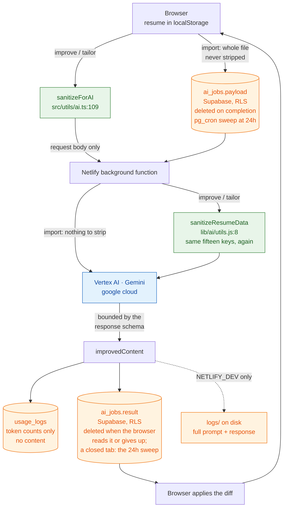

# What KiwiCV sends to the AI

> **Last verified: 2026-10-08** against `netlify/functions/`, `src/utils/ai.ts`, `src/utils/aiPayload.ts`, `src/components/modals/ai/edit/useAIGeneration.ts`, `src/components/modals/ai/import/useAIImportJob.ts` and `supabase/schema.sql`.

KiwiCV's AI features run on Google Vertex AI (Gemini). This page states exactly what leaves the
browser, what is removed before it does, where it rests on the way, and what is kept afterwards.

It describes the code as it is, including the gaps. Where something is sent that arguably need not
be, that is written down rather than rounded off.

## The short version

|                             | Import a CV                                                                                                     | Improve / tailor                                                                       | Cover letter                               |
| --------------------------- | --------------------------------------------------------------------------------------------------------------- | -------------------------------------------------------------------------------------- | ------------------------------------------ |
| **Sent**                    | the original file, whole                                                                                        | the CV, minus 15 stripped keys                                                         | a reduced projection of the CV (see below) |
| **Photo, email, phone**     | **sent** — it is in the file                                                                                    | removed                                                                                | removed                                    |
| **Postal address**          | **sent** — it is in the file                                                                                    | removed                                                                                | removed                                    |
| **Rests in the database**   | the file, then the parsed result, until read or the import is given up; a closed tab leaves it to the 24h sweep | the result, until read or the run is given up; a closed tab leaves it to the 24h sweep | the letter, the same way                   |
| **Content kept afterwards** | no                                                                                                              | no                                                                                     | no                                         |

## The two sanitizers

**The AI gets what the CV can show, and nothing it never can** (owner ruling, 2026-10-05). Hidden entries and sections are sent: they are content the user can show again, and a
translation has to cover them. What KiwiCV never renders is stripped below, alongside the
contact data. `selectAITargetData` (`src/utils/aiPayload.ts`) picks the target; a target that
no longer exists fails before a request is spent.

Every improvement, tailoring and translation run then passes the CV through a key-strip that
removes the same fifteen keys, recursively, at every depth:

```
image · email · phone · url · profiles · references · recipient · location*
visible · imageVisible · _imageVId · _isNew
passthrough · roles · keywords†
```

\* `location` is stripped only where it is the postal-address object. An entry's city is a
string under the same key and is still sent — see below, because getting this wrong breaks
translation.

† `keywords` is stripped only on a project (the one item with a `description`); skills and
interests show theirs on the CV and still send them. `passthrough` holds imported blocks KiwiCV
does not model, and `roles`/project `keywords` are kept for JSON Resume round trips — none is
shown, so none is sent.

⚠️ **`recipient` is the cover letter's addressee** — a _third party's_ name,
company and postal address. A `cv`-target run sends the whole resume
(`useAIGeneration.ts`), so those fields left the browser on every Improve,
tailor and translate until 2026-09-04. No mode could ever return them.

It runs **twice** — once in the browser before the request is sent, and again on the server before
the model sees it:

| Where                          | File                                  |
| ------------------------------ | ------------------------------------- |
| Browser, before the request    | `src/utils/ai.ts:109`                 |
| Server, before the Vertex call | `netlify/functions/lib/ai/utils.js:8` |

The call site is pinned by `aiPayloadContent.test.tsx`: the real request body carries no
pass-through block, no project roles or keywords, and only keys KiwiCV models.

Two passes is deliberate defence in depth: the server cannot trust that a request came from the
app. The two lists are separate literals — one runs in the browser bundle, the other in a Netlify
function outside the app's tsconfig — and
`src/utils/__tests__/aiSanitizerParity.test.ts` reads both as text, and also RUNS both
over one CV and compares the results — a guard that lives beside the list rather than in it is
invisible to a parser that only reads the list.
That guard matters because the drift is asymmetric: a key added to the server only is harmless,
while a key added to the _client_ only means the server keeps forwarding that field for any request
that did not come from the app.

### ⚠️ `location` is stripped by SHAPE, and that is not fussiness

Two different fields carry the name, and only one of them is the postal address.

| In the CV                          | Shape  | On an AI run                                  |
| ---------------------------------- | ------ | --------------------------------------------- |
| `basics.location`                  | OBJECT | stripped — unreturnable on any strip path     |
| an entry's `location`, six of them | STRING | **sent** — a translation run returns the city |

The strip list matches key names recursively, so adding `location` to it and stopping there removes
the entry cities as well. Measured, against the real sanitizer: a CV whose `work[0].location` was
`"Berlin"` and `education[0].location` `"Munich"` came back with both gone. `TRANSLATION_COMPOSITION`
adds `entryLocation` to every section that has a city — work, volunteer, education, awards, projects
and privateProjects — precisely so they can be translated, and `generator.js` marks every composed
field required. So a stripped city is not an omission: it is a mandatory field the model must fill
without having seen the input, written back over the real one, with nothing failing. Hence the shape test beside the list, and the behavioural half of
`src/utils/__tests__/aiSanitizerParity.test.ts`, which runs both sanitizers rather than reading them.

`FIELD_DEFS` already types the two apart — `location` is `OBJECT`, `entryLocation` is `STRING` — and
the store coerces `basics.location` to the object shape on every load (`validation.ts:1144`).

## Sent versus returnable — two different limits

A common misreading, worth stating plainly: the `*_COMPOSITION` maps in
`netlify/functions/lib/ai/definitions.js` define the **response schema**. They bound what the model
may _return_. They do not filter the request.

- **What is sent** = the CV object minus the fifteen stripped keys (`buildVertexRequest` in
  `vertex.js` serialises it whole), and on a whole-CV run minus the cover letter as well. On the server, the unsanitized CV exists only as the
  sanitizer's input. The schema's required sections, the mock engine and both Vertex calls all
  read the sanitized copy, and `tests/netlify-functions/improve-request-boundary.test.mjs` asserts
  that no stripped value is in any request a real run sends: whole-CV with its letter,
  translation, letter-only, section and item.
- **What may come back** = only the fields named in the composition for that mode.

So a narrow composition is not a narrow payload. The one exception is the cover-letter call, which
sends its own reduced projection rather than the whole CV.

## Per operation

### Importing a CV

The **entire original file** is sent — a base64 PDF inline, or extracted text for other formats
(`buildVertexRequest`, the `cv_parsing` branch). The strip lists above never run on this path — `sanitizeResumeData` is
imported only by `improve-cv-background.mjs` and `lib/ai/coverLetter.js` — and nothing could be stripped anyway: the photo, email, phone and address
are the point of the operation, and they are inside the file. It is capped at
`AI_MAX_UPLOAD_BYTES` (5 MB), server-side — the file picker applies the same limit, but a direct
POST never runs the picker.

This is the only path where CV content **rests in the database**. The browser writes the file into
`ai_jobs.payload` (`useAIImportJob.ts`) so the background function can pick it up, and the worker
writes the parsed CV — photo, email, phone and address included — into `ai_jobs.result`. The
browser deletes that row on every exit the run lives to see, its own 180 s poll timeout included,
and before importing a completed result; the lifecycle is `useAIJobRun`'s
(`src/hooks/useAIJobRun.ts`), argued once on `ops/AI_LOGIC.md` § One run, one outcome. An import
the client gives up on therefore has no row for a late parse to land in. A refused delete resolves
rather than throws, so it is logged (`deleteJobRow`, `src/services/aiJobs.ts`). What
that cannot cover is a **tab closed mid-import**: the job id lives in the hook, so the row waits for
the `pg_cron` job that sweeps anything orphaned:

```sql
DELETE FROM public.ai_jobs WHERE created_at < now() - interval '23 hours';
```

It runs hourly, so a row can wait up to 59 minutes past the predicate: the worst case for an
import that fails badly is just under 24 hours at rest, in Supabase, under row-level security —
inside the "24 hours at the latest" the Terms and Privacy Policy promise.

### Improving a section or an item

The section or item, minus the fifteen stripped keys. The response schema allows only the fields in
`SECTION_COMPOSITION` for that section — which is why an improvement never returns a URL or a
contact detail even when one was visible in the input.

The cover letter is one of those sections. `recipient` is on the strip list, so the
letter is sent as its subject, paragraphs, date and layout — the addressee stays in the browser —
and `SECTION_COMPOSITION.coverLetter` is `['subject', 'paragraphs']`, so nothing else can come
back. That keeps the recipient _block_ in the browser, not the addressee's _name_: a letter that
greets the contact by name carries it in `paragraphs[0]`, which is sent, and the generator
writes it there whenever the ad names one.

⚠️ **No CV content is written to `ai_jobs` on the way OUT.** The row the browser creates carries
`id`, `user_id` and `status` only (`useAIGeneration.ts`); the CV travels in the HTTP request
body and is never persisted.

⚠️ **The way back is different.** The worker writes the model's `improvedContent` into
`ai_jobs.result` (`improve-cv-background.mjs`) — rewritten summaries and highlights, no contact
details, since nothing can return those. The browser deletes the row on every exit the run lives
to see, through the same `useAIJobRun` lifecycle as the import. A run abandoned by
the client therefore has no row for the worker's later write to land in; the request is still
billed. The browser polls every 2 s for 60 s plus 1 ms per character of
the payload it sent (`aiPollWindowMs`) — about 5 minutes at the 256k-character cap — and a
completed result is collected on the next poll, so the window bounds how long an _in-flight_
row is kept, not how long a result rests.

What that cannot cover is a **tab closed mid-run**. The job id lives in the hook, so nothing can
collect or delete that result after a reload, and it rests until the 24-hour `pg_cron` sweep. The
client deletes rather than marks a row failed; the reason is on `ops/AI_LOGIC.md` § The poller
window.

### Custom sections

User-defined sections travel like any other section: their heading and entries, minus the
same fifteen keys — so an entry's `url` and `visible` never leave the browser, while the
section's `id` and each entry's `_vId` do, because the answer is matched back by them. A
response can carry them back: entry `name`, dates, `summary` and `highlights`, and the
heading on a translation only. A `section:` or `item:` run on one sends that section or entry
alone.

### Tailoring the whole CV to a job ad

As above, plus the job description the user pasted, and `meta` removed
(`improve-cv-background.mjs`, before the sanitizer runs). The cover letter reaches the worker but
not Vertex: the user turn carries only `WHOLE_CV_SECTIONS` (`projectForWholeCv`, `lib/ai/utils.js`),
since the response schema could not return the letter anyway. Its own call, when asked for, is
separate and is described below. Free text is capped at
`AI_MAX_CHAR_LIMIT + 500` characters server-side (`validateImproveRequest`, `lib/ai/request.js`).

The CV payload is capped server-side at `AI_MAX_PAYLOAD_CHARS` — **256,000 characters**, on the
order of 64,000–85,000 tokens (an estimate from the character count, not a measurement; JSON
punctuation tokenises poorly). The cap exists because `AI_PRO_DAILY_LIMIT` counts **requests**, not
tokens: without it, 200 oversized runs spend the same quota and a very different amount of Vertex.

Sized against measured CVs rather than a round number:

| CV                                                      | characters | headroom |
| ------------------------------------------------------- | ---------- | -------- |
| a committed `examples/*.json`                           | 7,432      | 34×      |
| a professor with 200 publications                       | 79,601     | 3.2×     |
| 20 jobs of ten highlights, 15 projects, 40 publications | 82,219     | 3.1×     |
| 50 jobs carrying 1,000 highlight bullets                | 204,227    | 1.3×     |

⚠️ **The binding row is the third-from-last, not the last.** A 200-publication academic is a real
CV, and it is where a cap set too low begins refusing people — silently, as a failed run carrying
the generic error, with nothing saying why. The bottom row is not a target to clear; it is the
evidence that 256,000 refuses nothing a human writes.

### Drafting a cover letter

Two controls send it, and they hand it different CVs:

- **After tailoring.** A whole-CV tailoring run with a cover-letter block makes it a second call
  in the same background job, after the tailoring call. The letter's retry re-runs that
  second call alone. Either way the CV is the one tailoring produced.
- **From the Cover Letter section** ("write from the ad"). This sends a letter-only request on the
  whole CV. No tailoring call runs, so the CV is the user's own, as the editor holds it.

Either way it sends a deliberately reduced projection rather than the CV: `COVER_LETTER_COMPOSITION` names it — `basics.name`, `label` and
`summary`; each job's `position`, `name`, dates and `highlights`; each skill group's `name` and
`keywords`; each degree's `institution`, `area` and `studyType`; each project's `name` and
`description` — and `projectForCoverLetter` (`netlify/functions/lib/ai/utils.js`) keeps exactly
those keys from the sanitized CV, tailored or not. No references, languages, certificates,
awards, URLs or locations. On the committed example CV that is a third of the sanitized payload,
not the half the epic estimated.

⚠️ **After tailoring, the projection carries call 1's output.** The worker writes the model's `improvedFields` back onto the sanitized CV, runs the sanitizer over the
result, and projects that — so the summaries and highlights the letter reads are the rewritten
ones, not the ones the browser sent. Nothing new leaves the browser for this: the second call is
built entirely from what call 1 already had and what call 1 returned. The Cover Letter section's
request projects the CV it was sent, through the same sanitizer and the same composition.

`basics.name` is in the projection although the prompt forbids writing it — the app prints the
signature. It is there for the candidate's gendered forms in inflected letter languages (a German
letter says "als Softwarearchitektin" or "als Softwarearchitekt"), and it already leaves the browser
on every whole-CV Improve, which strips no `name`.

Also sent, in the same user turn: the job description, and the writing sample if the user
supplied one — user prose that the prompt scopes to manner and forbids as a source of
facts. The sample is whatever the user pastes, often a previous letter whole, so it may carry a
former employer, an addressee's name or personal detail the user once wrote. It travels in the
request body, bounded at `COVER_LETTER_STYLE_MAX` (5,000 characters) on the server, which is the
copy that binds — the browser's field applies the same cap as an affordance a direct POST never
runs. Over the cap it is truncated rather than refused, since the sample governs manner alone.
Nothing writes it to `ai_jobs` or `usage_logs`, and only the `NETLIFY_DEV` logger sees it, on
local disk.

⚠️ **The sample is the one AI input that rests on the user's own device between runs.** The app
remembers it under `BRAND_STORAGE_KEYS.coverLetterStyle`, in `localStorage`, because the field
IS the preference — re-pasting a voice that works on every run is friction with no upside. That
puts it outside `resume.json`, so it is in **no** JSON export and in **no** Drive backup, and it
is not covered by the sanitizers, which never see it: it is not part of the CV. Clearing site
data or switching browsers loses it and there is no cloud copy, which is what the "Saved on this
device" line beside the field says out loud.

What comes back is bounded by `getCoverLetterSchema()`: a subject and the
paragraphs, the same two fields Improve returns. No recipient field — a named contact is greeted
in `paragraphs[0]`, and the recipient block stays the user's to fill. The letter returns the way
every result does, through `ai_jobs.result`, so it rests there until read or swept — the same gap
as above, inherited rather than added to.

A letter that fails returns nothing at all: `ai_jobs.result.coverLetterError` carries a class name
(`LETTER_TRUNCATED`, `LETTER_INVENTED_YEAR`, …) and no letter text, beside a CV result that is
still complete.

## What is kept afterwards

**Nothing is kept afterwards: no prompt, no CV content and no model output.** Model output does
rest in the database temporarily, in the job's `ai_jobs.result` row until the client reads it or
the 24h sweep removes it (above). What outlives the run is `usage_logs`, and it records accounting
only (`schema.sql:84`):

```
user_id · request_type · package_used · tokens_input · tokens_output · model_used
details{ latency_ms, region, finish_reason, safety_ratings, is_noop, is_mock, prompt_version,
         context{ granularity, mode, activeTarget } } · created_at · pending_until
```

`pending_until` is set while a request is in flight and cleared once it succeeds. A request that
fails has its row deleted at once, or within the hour after its reservation expires if the worker
could not delete it.

`activeTarget` names the kind of thing improved, not which one or what it said: `cv`,
`section:<key>` or `item:<key>`, a custom section as `custom`, and `unknown` for anything else
(`aggregateAITarget`, `lib/ai/request.js`). Entry and section ids are dropped before the row is
written: an imported CV keeps its ids verbatim, so one can be free text — a name, an
employer — and a direct POST never runs the client sanitizer. It is the shape PostHog gets: every
AI event reports the target through `getAITrackingParams`, which drops the `_vId` and reports a
custom section as `custom`. The dev-only log file is named by the same aggregate.

`mode` is recorded the same way, in `details.context.mode` and, on an import row
(`request_type = cv_parsing`), in `details.mode`: a key of `BASE_ROLE_PROMPTS` — `professional`,
`job_description`, `custom`, `translate_close`, `parse_import` — else `unknown`
(`aggregateAIMode`, `lib/ai/request.js`). Both workers read the mode from caller-written text
(the request body, `ai_jobs.payload`). An unknown mode is not refused: an improve run falls back
to `professional`, an import runs plain `parse_import`, and only what is stored is bounded.

**At Google, on the project's default settings** (read 2026-10-06; the owner kept them): Vertex's
`cacheConfig` returns `retentionType: DURABLE` and no `disableCache`, so Google may cache inputs and
outputs for up to 24 hours — per a Google notice quoted second-hand, on disk rather than in memory
for Gemini 3.x from 2026-10-15; `EPHEMERAL` or `disableCache: true` is the opt-out. With no
abuse-monitoring exception, Google may keep a prompt its automated safety systems flag for up to
30 days, not for training. Privacy Policy §8 says exactly that, without "in memory", so it holds
either way; if the cache is ever turned off, shorten §8 with it.

Full prompts, inputs and responses **are** written to disk — but only in local development. The
logger returns immediately unless `NETLIFY_DEV === 'true'` (`lib/ai/logger.js:23`), and it writes
into `logs/`, which is gitignored.

## The path a CV takes



## Known gaps

Recorded rather than hidden. None is a live incident; each is a thing a reader should not have to
discover from the source.

1. **The entry cities are sent on Improve and Tailor, where nothing can return them.** The
   sanitizers are mode-blind — `sanitizeResumeData` never sees `targetLang` — and `entryLocation` is
   in `TRANSLATION_COMPOSITION` and `PARSING_COMPOSITION` only. So the city of every job, degree and
   project goes out on runs that have no field to send it back in. Strictly smaller than the address
   the sanitizers already remove, and closing it needs a mode-aware sanitizer rather than a list
   edit.
2. **The shape guard reads a value the server cannot vouch for.** A hand-rolled POST whose
   `basics.location` is a STRING is forwarded intact, because the guard reads it as a city. The app
   cannot produce that — `validation.ts:1144` coerces the field to the object shape on every load —
   so the exposure is bounded to a caller hand-crafting a payload out of their own data.

Closed since this page was written: the two sanitizer lists are pinned against each other by
`src/utils/__tests__/aiSanitizerParity.test.ts`, both the CV payload and the import upload
are capped server-side, and a whole-CV run no longer drops an object-shaped section — the
apply path and the no-op grader each read the shape off their own copy of the CV, rather than
testing for the name `basics`. An Improve, tailor or translate run the client gives up on no
longer leaves its result at rest — the row is deleted on the timeout and failure exits too, and
the timeout itself now grows with the payload instead of cutting off a large translation at 60 s.
The import poller now does the same on its timeout, `failed` and could-not-start
exits, and no longer attempts the `UPDATE` to `failed` that row-level security refuses. Both
pollers delete the row when their dialog unmounts mid-job, and neither applies a result read after
it showed the timeout's error. Still open: the import's 180 s window is flat rather
than derived, because a whole document is not the CV JSON the improve formula measures, and a tab
closed mid-job leaves its row to the 24-hour sweep, which only a server-side change could shorten.

## Related

- `.agent/wiki/ops/AI_LOGIC.md` — the pipeline itself: modes, prompts, the import job end to end.
- `.claude/rules/ai-backend.md` — what binds when changing any of it.
- `supabase/schema.sql` — the tables, policies and cron jobs quoted above.
